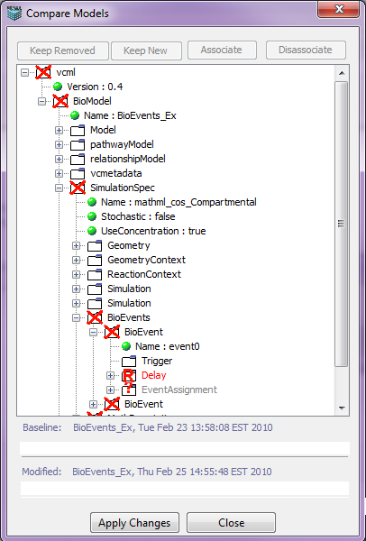

# Compare With Saved

It is difficult to compare models by simply visually inspecting the different components. Instead,
the best way to compare models is with the Compare Models feature which automatically performs a
side-by-side comparison of all the different components of the model.

The models are compared and the user is presented with a composite model in a **Compare Models**
dialog, shown above, where only differences are indicated. An **"X"** will indicate which part of
the model is different. The **"X"** will originate at the parent level in the tree and travel down
the tree wherever there is a difference between the two models. At the level where that item is, it
will be marked with a **"?"**. Items that are only in the modified model are marked with an **"N"**
for **new**. Items that are only in the baseline model are marked with an **"R"** for **removed**;
they are considered to be removed from the modified model.

When any of these items are selected, the value in the baseline model and the modified model are
displayed in the text area below. If the user is aware that any two similar items (for example., 2
species in the models being compared) represent the same entity, the two items can be selected and
the **Associate** button can be clicked to associate the two items. Similarly, **Disassociate**
button will dissociate two similar items in the two models being compared. This will not alter the
original models in any way.
