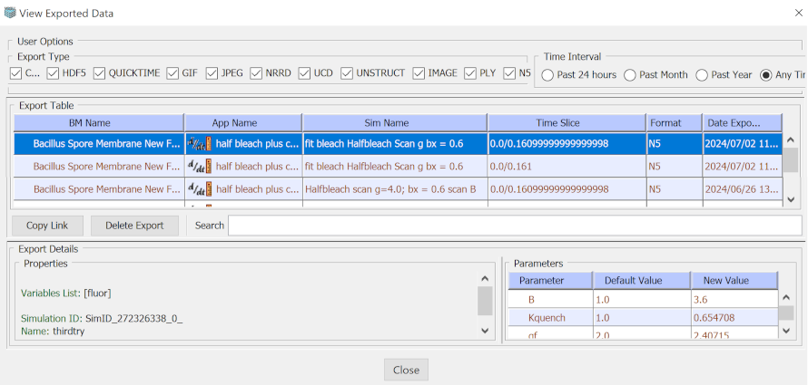

# Exported Data Viewer

The **Exported Data Viewer** lists exported spatial simulation results that can be accessed or
viewed by the user.

The table lists all exported spatial simulation result sets that were exported using the current
local computer. For each exported dataset, the table reports the associated BioModel Name (BM Name),
Application Name (App Name), Simulation Name (Sim Name), Time Slice exported (first/last), file
Format, and Date Exported.

**Filter** by selecting or deselecting the checkbox for Export file Type or Time Interval since the
data was exported.

**Copy Link** copies a link to the selected dataset stored on VCell servers. The link will allow
other analysis or viewing software (e.g. Fiji/ImageJ, Excel) access to the data. The link can be
shared with others and provides access only to the specific exported dataset.

**Delete Export** deletes any selected exported datasets from the servers.

**Search** any information in each of the columns to filter the table.

**Export Details** describe the variables exported, simulation ID and Name, and the link itself and
can be selected and copied using "ctrl-c"

A **Parameters** table lists any Application parameters overwritten from default values for the
Simulation that was exported; this distinguishes among different simulations when scanning parameter
values.

<!-- Author comments:
Exported N5 files can be viewed directly from the server using Fiji/ImageJ. A VCell Dataviewer plugin to FIJI/ImageJ can be installed from https://sites.imagej.net/VCell-Simulations-Result-Viewer/
-->
