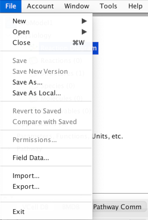
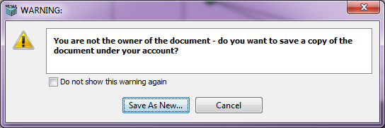

# File

The **File** menu allows the user to perform several file operations on the currently open VCell
Document.

Clicking the File menu displays a popup menu with the following choices:

- [New](New.md)
- [Open](Open.md)
- **Close** - closes the currently open document.
- **Save** (**Cmd+S** on macOS, **Ctrl+S** on Windows and Linux) - saves the current document to
  database, overwriting the older version. Note that this menu option, and its shortcut, are
  disabled for a new document. For saving a new document, refer to [Save As](SaveAs.md). Also, when
  the user modifies a public model or a model that has been shared by another user and tries to save
  the model, the "Save" option is enabled. Choosing this option brings up a warning dialog that the
  model does not belong to the current user and it has to be saved as a new model in the current
  user's account. Clicking [Save As](SaveAs.md) brings up the "Save As" dialog. **Cancel** cancels
  the save operation.

- **Save New Version** - saves copy of document to database as a new version (with same name but
  latest time stamp).
- [Save As...](SaveAs.md) (**Cmd+Shift+S** on macOS, **Ctrl+Shift+S** on Windows and Linux) - saves
  copy of document to database with new name.
- [Revert To Saved](RevertToSaved.md)
- **Compare With Saved** - compares the currently open document with its latest saved version in the
  database and displays the result in a separate window. Refer to the section on
  [Compare With Saved](CompareWithSaved.md) for further information.
- [Permissions...](Permissions.md)
- [Field Data...](FieldData.md)
- [Import...](Import.md)
- [Export / Save to File...](Export.md) - saves a copy of the document as a file on your computer,
  as VCML (selected to begin with) or in another format. This replaces the former **Save As
  Local...**. If the model has changes not yet saved to the database, VCell first offers to save
  them there too; the file includes them either way.
- **Exit** - exits the Virtual Cell, closing all open documents and prompting user to save any
  unsaved document(s).
