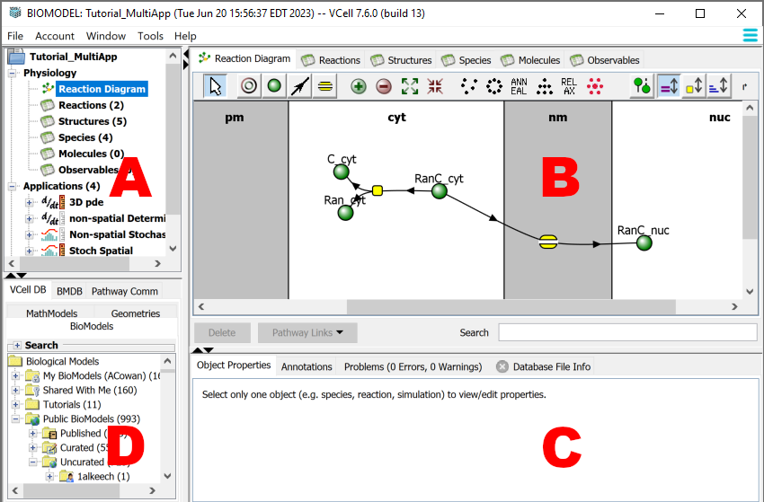

# General Navigation and Window Setup

The document view displays the model at a glance, with intuitive tabs and tree structures that
allows the user to navigate a Biomodel with ease. Note that some of the elements described are
required for rule-based modeling, which is also available within VCell.

A [top-level menu](TopMenu.md) allows the user to perform various operations on the VCell document,
such as save or export a model or share a model for collaborative viewing. Three panels within the
document window present the user with a canvas to browse, create and maintain a model.

Top left is a **Navigation panel (Panel A)** that allows navigation of the currently open model.
Each entry is a row across the panel: the deeper an entry, the shorter its row (the deepest are in
italics, set in a little). Clicking a section with a chevron on its right opens it, and its
subsections drop down beneath; clicking it again folds them away, and clicking the chevron itself
folds or unfolds without opening the section. The arrow keys move through the rows, and Left and
Right fold and unfold. Its top item is the model itself (its saved information and annotations);
under it come **Mathematics & Units**, which covers the whole model, then the **Physiology**, and
the model's **Applications**. The pathway's views are in a window of their own: **Tools > Pathway
Tools...**. Physiology opens on the Reaction Diagram (it has the diagram's icon) and links to the
components of the BioModel, including:

- A [Reaction Diagram](../Physiology/ReactDiagView.md) view
- [Reactions](../Physiology/ReactTabView.md) in a tabular view
- [Structures](../Physiology/PhysStructTabView.md) (compartments) in a table view
- [Species](../Physiology/SpeciesTabView.md) list in a table view
- [Molecules](../Physiology/Molecules.md)
- [Observables](../Physiology/Observables.md))

The Tree Structure also provides links to

- [Mathematics & Units](../ParametersAndFunctions/ParametersAndFunctionsOverview.md): the model's
  parameters and functions (VCell's built-in constants and math functions among them), with its
  Model Unit System a button away
- [Applications](../BioModelApplications/ApplicationOverview.md)

**View items** in the View Panel (panel B, top right panel) by selecting the item in the tree. For
example, choosing the "Reaction" item under "Physiology" in the navigator tree will open the table
of reactions in the model in the 'View' panel.

**View a summary** of the model by selecting the name of the BioMdoel at the top level of the
navigation tree in the "Navigation" panel. The summary contains the model's name, owner, last
modified date, permissions to view the model (also refer to [File -> Permissions](Permissions.md)),
and a brief summary of each of the Applications in the BioModel.

A **View Panel (Panel B)** on the top right provides workspace to view and build the Physiology,
with 6 tabs corresponding to items under physiology in the tree structure in the Navigation Panel
(Panel A).

- [Reaction Diagram](../Physiology/ReactDiagView.md) is used to visualize and create the reaction
  network within different compartments. Compartments, species and reactions or fluxes can be added
  to the BioModel physiology in this workspace.
- [Reactions](../Physiology/ReactTabView.md) lists the reactions in a tabular form. The user can
  also add/delete reactions here.
- **Structures** lists the compartments in the model in a table. Compartments can also be added or
  deleted in this table.
- **Species** lists the species of the model in a table.
- **Molecules** list the seed species for a rule-based model and depict the possible states for each
  molecule.
- **Observables** list the functions that define groups of molecular states or species that are
  created in rule-based models.

A [Properties Pane](../PropertiesPanes/PropertiesPaneOverview.md) (Panel C) on the bottom right of
the VCell document window allows the user to view and edit different properties for an object
depending on the tab selected.

- **Object Properties** displays the properties of any entity
  ([species](../PropertiesPanes/PP_Species.md), [reaction](../PropertiesPanes/PP_Reactions.md),
  [structure](../PropertiesPanes/PP_Structures.md), [molecule](../PropertiesPanes/PP_Molecules.md))
  selected in any of the tabs in the "View" panel.
- [Annotations](../PropertiesPanes/PP_Annotations.md) displays annotations for any entity (species,
  reaction, structure, molecule) selected in the "View" panel, or the overall Model if selected in
  the Navigation Panel
- [Problems](../PropertiesPanes/PP_Problems.md) lists the errors and warnings in the model that has
  been created. The user is not allowed to save the model if there are any errors. However, the
  model can be exported as a [VCML file](Export.md) should the user need to exit before fixing an
  error.
- [Database File Info](../PropertiesPanes/PP_VCellDatabaseInfo.md) provides a database summary of
  the open model when it is selected at the top of the Navigation panel.

Models stored in the [VCell Database](../DatabaseSources/VCellDatabase.md) and the
[BioModels Database](../DatabaseSources/BioModelsNet.md) are browsed, searched and opened from the
**Welcome window** (**File > Welcome Window**), rather than from a panel of the document window.
Pathways from the **Pathway Commons** database are searched from the **Pathway Lookup** tab of the
Pathway Tools window (**Tools > Pathway Tools...**). Please refer to sections
[Pathway Commons Database](../DatabaseSources/PathwayCommonsPanel.md) and
[Biological Pathways](../BiologicalPathways/PathwayOverview.md).
