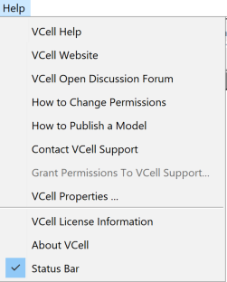
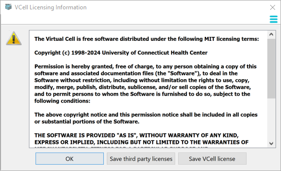
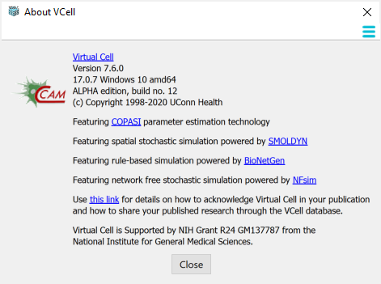

# Help

The **Help** Menu bar option provides information of the currently launched VCell version.

Clicking the Help menu shows the possible menu item selections. Selecting

- **VCell Help** (or pressing **F1**) - opens this help at the page about what you are looking at:
  the part of the model you have open (for example the Reactions table, or an application's
  Events), or the window in front, such as simulation results or the Model Explorer. Where no page
  covers it, the help opens on its contents. A small round **?** beside part of a window, or in the
  corner of a window that has no menu bar, opens the page about that part.

- **VCell Website** - launches a separate web browser that goes to the Virtual Cell web page.

- **VCell Open Discussion Forum** - launches a separate web browser that goes to the VCell Google
  Groups Forum.

- [Permissions...](Permissions.md) - explains how to change access to your model by specific users
  or by the public.

- **How to Publish a Model** - describes the steps to provide access to your model to the public and
  how to cite the VCell resource.

- **Contact VCell Support** - opens an email to vcell_support@uchc.edu

- **Grant Permission to VCell Support** opens the [Permissions...](Permissions.md) dialog box with
  the item "Grant Access to Specific Users" selected and the VCellSupport box checked. If you are
  seeking advice from the VCell support team, it is recommended that you share that model with
  VCellSupport by selecting "OK"

- **VCell Properties** - displays locations for local files including the Installation Directory and
  VCell Home Directory.

- **Virtual Cell License Information** - shows a dialog that displays the license information for
  the Virtual Cell.

  

- **About The Virtual Cell** - pops up a dialog that displays the Version and edition of the
  currently launched VCell.

  

- **Status Bar** when selected shows a status bar at the bottom of the VCell main window stating the
  connection status and memory usage.
