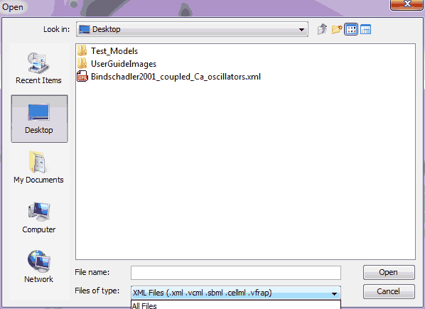

# File -> Import

**VCML** is the **V**irtual **C**ell **M**arkup **L**anguage and the native Virtual Cell format. The
Virtual Cell supports interoperability with other standard representations for biological systems
modeling. Formats that can be imported into the Virtual Cell include SBML levels 1, 2, and 3
(limited) and VFRAP. For SBML imports, it is preferrable to use Level 2, since it is more
comprehensive than Level 1 and better supported that Level 3.

**Note:**

- Presently, models can be imported into the Virtual Cell only as BioModels.
- Each SBML model is imported as one BioModel with one non-spatial application

To import a file into the Virtual Cell, choose **File -> Import**. This opens a "Choose File"
dialog. Navigate to the folder where the file to be imported is stored. Click **Open** to import the
file or **Cancel** to cancel the operation.

**Unit conversions from SBML**

While importing an SBML model into the Virtual Cell, the units are converted into Virtual Cell
default units. Note that species in SBML can be represented in terms of substance units or
concentration units, whereas Virtual Cell represents species only in terms of concentration. An SBML
species which is defined in substance units is converted to concentration units in the Virtual Cell
by dividing the quantity in substance units by the size of the compartment in which the species is
located. Also, reaction rates in SBML are defined in terms of substance/time, which are converted to
concentration/time while importing into the Virtual Cell.

- **Concentration**

  The unit conversion factors for species concentration are not explicit to the user. However,
  conversion factors (of the form species\_**ConcFactor**) may be found in the
  [Species Specifications](../BioModelApplications/Specifications/SpeciesSpecifications.md) tab of
  an application. A multiplicative factor may be found along with the actual value specified in the
  SBML model, e.g., 0.01 \* 1000000, which means that 1000000 is the unit conversion factor for the
  species.

- **Reaction rate**

  Reaction rate unit conversion factors can be seen in the
  [Reactions Properties Pane](../PropertiesPanes/PP_Reactions.md) for a reaction. A factor
  **sbmlRateFactor** that represents the unit conversion for the entire reaction rate (from
  substance/time units to concentration/time) will be present in the list of reaction rates and
  defined parameters. For reaction rate expressions that include a species, a corresponding
  concentration factor is also present. For example, if a reaction rate expression contains species
  s1, s1 is multiplied by s1_ConcFactor to appropriately convert the species units.

  These conversion factors will also be visible under
  [Parameters and Functions](../ParametersAndFunctions/ParametersAndFunctions.md) pane that can be
  accessed by navigating the tree structure in the top left pane of the VCell BioModel document. In
  both these places, these concentration and species factors mentioned above appear suffixed with
  the corresponding reaction name.

**SBML models with multiple compartments**

When importing an SBML (level 2 or 3) model with more than one compartment, it is important to
verify that it has a specified relationship between the different compartments. For the Virtual Cell
to specify the correct cellular structures to each compartment, the relationship between
compartments must be indicated within the SBML file. This is achieved by specifying in SBML the
'outside' attribute for a compartment, and its spatial dimension. In the Virtual Cell, Features have
a spatial dimension of 3, while membranes have a spatial dimension of 2.
