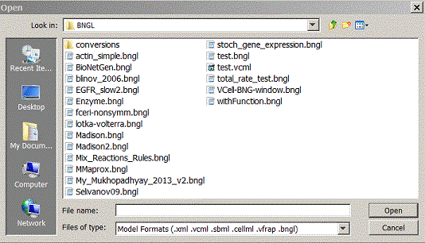
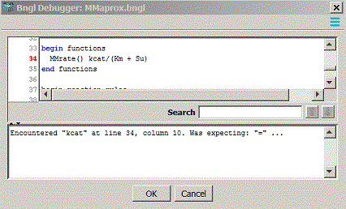

# File -> Import (BNGL files)

**BNGL** is the **B**io **N**et **G**en **L**anguage that is a native format for storing rule-based
models used in BioNetGen and NFSim simulators. VCell supports import of models encoded in BNGL.

To import a file into the Virtual Cell, choose **File -> Import**. This opens a "Choose File"
dialog. Navigate to the folder where the file to be imported is stored. Click **Open** to import the
file or **Cancel** to cancel the operation.

If some features in BNGL file are not supported by VCell, a pop-up window is launched with a
suggestion to correct unsupported features. In some cases, when some features in BNGL file (such as
fixed value of concentration) are supported by BioNetGen but not NFsim, only a single deterministic
rule-based application will be created.

**Unit conversions from SBML**

BNGL does not have defined units (units are implicit and must be consistent), while VCell must have
a defined unit system. During import, a user must define a default substance units for the imported
model as either Concentrations or Molecules. Note that Virtual Cell internally represents species
and kinetic laws only in terms of concentration, thus every number of molecules is converted to
concentration units in the Virtual Cell by dividing the quantity in substance units by the size of
the compartment in which the species is located. Also, reaction rates in SBML are defined in terms
of substance/time, which are converted to concentration/time while importing into the Virtual Cell.

- **Concentration**

  The user must define a concentration **scale** (Molar, micromolar or nanomolar) for numbers in
  BNGL file to define concentration units. Default **time** units must be defined as well.

  **Note:** While for BioNetGen application (deterministic), VCell simulation results will be
  identical to BioNetGen stand-alone simulation results, NFSim or BioNetGen stochastic simulation
  results depend on the volume set by a user. Suggested volume is 5,000 um3 - a volume of a typical
  cell, but user must be aware that the number of molecules in such volume may exceed the default
  200,000 molecules in NFSim simulation parameter - this number can be increased, but at a heavy
  computational cost. If the volume is set to 1, NFSim simulation results should average to
  BioNetGen simulation results - unless concentrations are set to be less than one, in which case
  stochastic simulations will be difgferent.

- **Molecules**

  The user defines default **time** units, simulation **volume** (the volume of a single compartment
  all species will be placed to) and **volume units**.

  **Note:** For BioNetGen application (deterministic), all units will be converted to concentrations
  using the provided volume. If volume is set to one, then VCell simulation results for either
  BioNetGen or NFSim applications will be identical to BioNetGen stand-alone simulation results.
