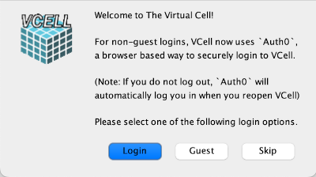

# Logging into VCell

The first time a user launches VCell, a dialog window appears for login options.

- **Login** redirects the user to the default browser of the local computer to authenticate using
  Auth0. At first use the user will be prompted to create a Profile in Auth0 that will link to the
  user's VCell Username. See the [Auth0 Profile Instructions](Auth0ProfilePage.md) .
- **Guest** logs in as the VCell Guest User (VCell Guest) and allows limited access to VCell to
  allow exploration of public VCell models.
- **Skip** dismisses the dialog and allows "offline" use of VCell, without connection to the servers
  or databases. Any models created in an "offline" mode need to be exported to VCML or SBML to be
  saved locally. The user can log in at any time using the "Account Login" menu item.
