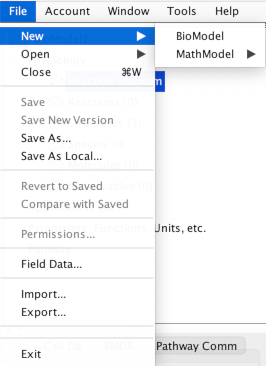
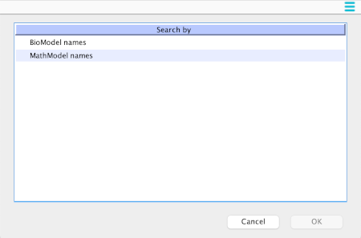
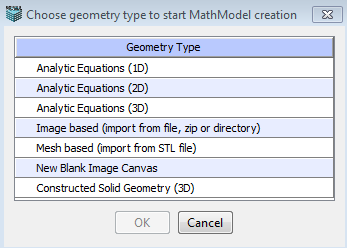
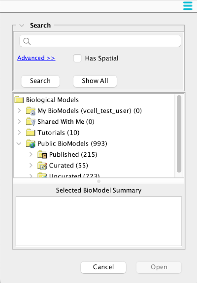
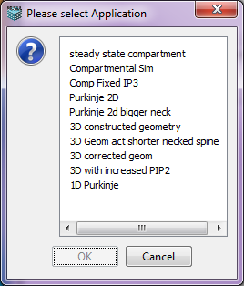

# File -> New

The **File->New** menu option allows the user to create a new VCell project (**BioModel** or
**MathModel**).

Clicking on the **File->New** menu option shows another menu where the user can choose to create
either a new **BioModel**, **MathModel**. Clicking on any of those options opens a new project of
the chosen type. Note that if the user wishes to create a MathModel, there are four further options
(provided in the next level of menu) to create a MathModel:

- **Non-spatial** - creates a non-spatial (with Ordinary Differential Equations) MathModel.

- **Spatial from database geometry** - creates a spatial MathModel where the spatial geometry is
  selected from VCell geometries stored in the VCell database (any geometry that belongs to the
  current user or that is shared by other users).

  

- **Spatial from new geometry** - creates a spatial MathModel from a new geometry. The image below
  shows the dialog the user is prompted with to create a new geometry. The geometry can be
  analytical (1, 2, or 3D); image-based (from VCell database or imported from image file and
  processed); mesh-based (from STL file); copied from a BioModel application or another MathModel or
  a saved Geometry from the VCell database; or created from scratch. For further information on
  creating geometries, refer to the section on
  [Geometry](../BioModelApplications/Geometry/GeometryOverview.md).

  

- **From BioModel** - creates a MathModel from an existing BioModel within the list of the user's
  BioModels (or those that are shared with the user). Upon selecting the BioModel, a dialog prompts
  the user to select an application from a list of all applications in the BioModel that should be
  converted to a MathModel. **Note:** Each application has a separate MathModel associated with it.

  

  

<!--
Not shown in the old JavaHelp build (it sat outside every section):

Virtual Cell also supports [rule-based modeling](../RuleBasedChapter/RuleBasedOverview.md), which
allows the representation of species as structured objects consisting of
[molecules](../Physiology/Molecules.md) and uses
[reaction rules](../Appendix/Definitions.md#reaction-rules) to define molecular interactions that
transform the attributes of species. The rule-based approach allows one to systematically
incorporate site-specific details of molecular interactions into a model.
-->
