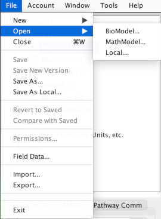
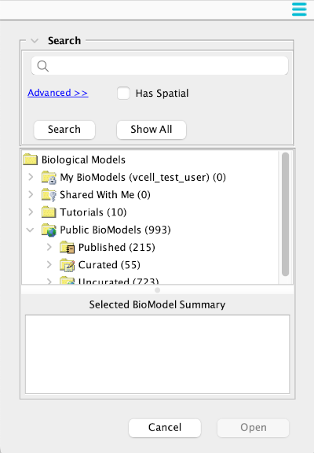

# File -> Open

This section describes the **File->Open** menu option. The **Open** menu option allows the user to
open an existing VCell document - BioModel, MathModel or Geometry - from the user's account or a
model shared by other users.

Clicking on **File->Open** menu option displays a dialog for opening a **BioModel...**,
**MathModel...** or **Geometry...** document. The dialog lists the documents of that type you can
open, the way the Welcome window does: a search field, your **Recent** ones, and the **VCell
Database** lists (Community, Personal and Tutorial). Double-click a document, or select it and press
**Open** or **Enter**. For example, clicking on 'File->Open->BioModel' will open a dialog that lists
all BioModels accessible to current user. The same dialog is used wherever VCell asks you to choose
a saved document: comparing with another model, creating a MathModel from a BioModel application,
choosing a geometry from the database or from another model's applications, and in the Testing
Framework. Additionally, **Local...** displays a local file chooser to select VCell documents saved
on the user's own computer (using 'File->Export / Save to File...').

