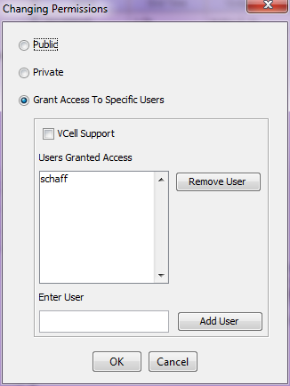

# File -> Permissions

Once a BioModel, MathModel or Geometry has been created and saved and is suitable for public
viewing, the model is ready to be shared. (If the model does not belong to the user, then the user
cannot change public viewing settings for the model). A model can be shared via the **Changing
Permissions** dialog.

The **Changing Permissions** dialog can be accessed by clicking on the **File -> Permissions...**
menu sequence in an open VCell document (BioModel, MahtModel, Geometry).

There are 3 options to share models : **Public**, **Private** or **Grant Access to Specific Users**.
By default, a user's model is **Private** which means that only the user has permission to view the
model. To make a model public to everyone using the Virtual Cell, select **Public**. Other users can
save a copy of current user's model as their own, and then have complete access to their own copy.
No modifications can be made to the user's original copy.

If the user wishes to share his/her model with specific Virtual Cell users, it can be accomplished
by selecting **Grant Access to Specific Users**. In the **Enter User** text field, the user can type
in the login name of each user to whom he/she wishes to give access and then click the **Add User**
button. **Note:** Entering a user login name and clicking on **OK** to dismiss the dialog without
clicking the **Add User** button will not add the user to the shared users' list. These users will
be able to access the shared model the same way that they access any other public model. To all
other users, this model would be invisible (like a private model). When the **VCell Support**
checkbox is checked, the VCell Support team gets permission to view the user's model if the user is
having any difficulties with the model. To remove a user from the list of users with whom the model
has been shared, the specific user login name is selected from the list of "Users Granted Access"
and the **Remove User** button is clicked.
