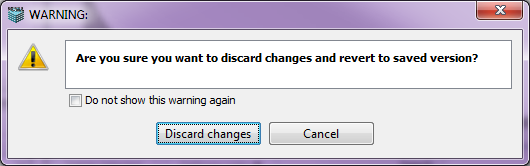

# File -> Revert To Saved

The **File->Revert To Saved** menu option allows a previously saved, open document/model that has
been modified to revert to the previously saved version.

If the document has been modified, the message shown above is displayed. The user can choose to
discard the changes and revert to the previously saved edition by clicking on **Discard Changes**
button, or cancel the 'Revert To Saved' operation.
