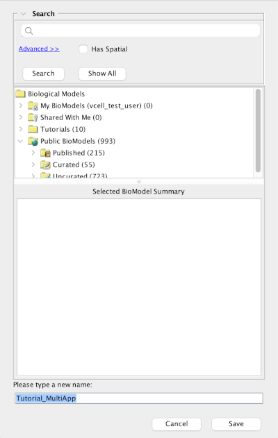

# File -> Save As

This section describes the **File->Save As** menu option. The **Save As** menu option allows the
user to save a new VCell document - BioModel or MathModel. The operation allows a document/model
that has already been saved to be saved as a different model, and a new model to be saved in the
database for the first time.

Clicking on **File->Save As** (**Cmd+Shift+S** on macOS, **Ctrl+Shift+S** on Windows and Linux)
opens the **Save As** dialog. Its **Name** field starts with the model's current name, selected, so
typing replaces it.

Below the field, **Similarly named BioModels** (or MathModels, or Geometries) lists your own models
of that type whose names are related to what you've typed: names containing it, and names it
contains (typing "FRAP model 2" lists "FRAP model"). Before you type, it lists them all. Click a
name, or select it and press **Enter**, to copy it into the field and build on it (e.g., adding
"\_v2"). The **Down** arrow moves from the field into the list.

The name is checked as you type. While it can't be used, the **Save** button is disabled and a
message under the field says why. A name can't be used if it

- is empty;
- contains line breaks, tabs, or other invisible characters;
- contains < or >;
- starts or ends with a space;
- is too long to store (255 characters, where a ' counts as 6 and accented letters as 2 or more);
- exactly matches (including capitalization) the name of one of your own models of the same type.

When the name is new, **Save** (or **Enter**) saves the model in the VCell database. **Cancel** (or
**Esc**) cancels the save operation.
