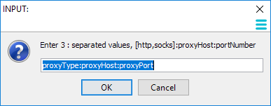

# SetProxy

Set Proxy allows a user to define a proxy to enable connection through a firewall

The dialog box should be completed exactly as indicated.

- Proxy Type can be either http or slocks
- Proxy Host is either a FQDN or IP Address
- Proxy Port is the port number
