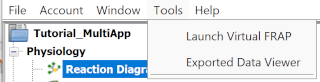

# Tools

The **Tools** menu bar provides tools that can be used to assist with model development and analysis
in VCell.

- [Launch Virtual FRAP](LaunchVirtualFRAP.md) - opens VirtualFRAP, a tool to analyze fluorescence
  photobleaching experiments using VCell spatial modeling technology.
- [Exported Data Viewer](ExportedDataViewer.md) - opens a table listing server links to access all
  Spatial Simulation Datasets that have been exported using while using the current local host.
