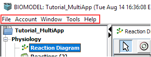

# Top Menu

This section describes the general menu options available to the user when a VCell document
(**Biomodel/Mathmodel/Geometry**) is created or opened.

The top menu options available to the user are

- [File](File.md),
- [Account](Account.md),
- [Window](Window.md),
- [Tools](Tools.md) and
- [Help](Help.md).
