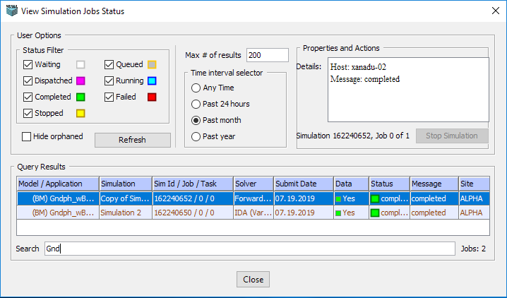

# ViewSimStatus

View Simulation Jobs opens a window that allows the user to search for VCell simulation jobs and
return a table of the simulation information; the user can also find and stop simulations that are
not yet completed.

The View Simulation Job Status window searches for simulation jobs under your username. **User
Options** provide selection for search parameters.

- **Status Filter** allows the user to select any combination of types of job status.
- **Max # of results** limits the number of results returned.
- **Time interval selector** allows the user to chooose among several time options.
- **Hide orphaned** when selected hides simulation jobs that are no longer associated with a
  Model/Application.

Select **Refresh** to initiate a new search after changing user options. Properties and Actions
provide details of a selected query result. **Stop Simulation** stops a selected simulation that is
currently running. Use the **Search** bar to filter the table of simulation jobs based on Model
Name. **Close** the window when finished.
