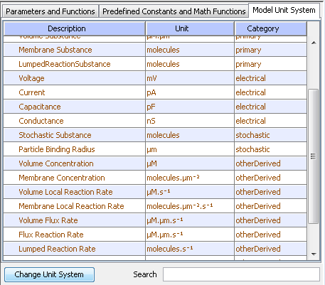

# VCell Model Units

Model units establish the base system of measurement for VCell quantities. Some units can be changed
(e.g. Time, Length, Diffusion, ...). Electrical units are fixed and cannot be changed (voltage mV,
current pA, capacitance pF, conductance nS).

Choose the model's units with the **Unit System** list beside the table, in the **Model Unit
System** window: open it with the **Model Unit System...** button below the Parameters and Functions
table (click **Mathematics & Units** in the Navigation panel). Choosing a different unit system converts the model's values to its units. The
list starts with VCell's own:

- **VCell Default**: the units VCell models start with (um, s, uM.um3 for volume species, molecules
  for membrane species).
- **SBML Compatible**: one substance unit for all species (umol, with l and dm), as SBML expects.

If a model's units match neither, nor one of yours, the list shows them as **Custom (this model's
own)**.

Beneath the list:

- **Add...** makes a unit system of your own: give it a name and its units, starting from the chosen
  system's (a model's own units included, to keep them under a name). A unit system doesn't change
  once added. Problems, such as a unit VCell can't read or a length unit that isn't a length, are
  shown as you type. The model is then converted to it.
- **Delete...** removes a unit system you added. Models keep their units; VCell Default and SBML
  Compatible can't be deleted.

Your unit systems are kept on this computer and listed in every model window.
