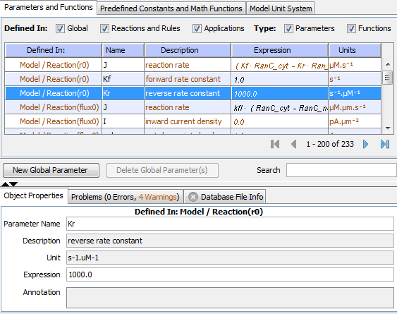

# Parameters and Functions

Users can define parameters to aid in modeling their virtual experiments or
[applications](../BioModelApplications/ApplicationOverview.md). User-defined parameters can be added
at the physiology level either as **global** parameters or as **reaction** parameters. There are
other predefined parameters such as species initial conditions, structure sizes or reaction rates
for the different kinetic types that are generated as the model is being developed, for which the
user has to provide values. The parameter values can be numeric or expressions involving other
allowable variables in the model. Parameter values that are expressions are referred to as
**Functions** in the Virtual Cell.

**Viewing/Editing Parameters and Functions**

- **Activate** by clicking **Parameters and Functions** under **Mathematics & Units** in the tree
  list of the **Navigation panel** (window upper left), which will display the 'Parameters and
  Functions' tab (window right panel). Its other tabs are listed beside it in the tree, in the same
  order as the tabs: **Model Unit System**, then Parameters and Functions, then **Predefined
  Expressions**.
- **View** by clicking the **Parameters and Functions** tab. A table of information including
  'Defined In' (where the parameter/function is defined), Name, Description (type of
  parameter/function), Expression (value of parameter/function), Units. **Defined In** can be
  'Global', 'Model/Reaction' (created in [reactions add/edit](../PropertiesPanes/PP_Reactions.md))
  and 'App' (varies in application, e.g. initial conditions, compartment size, diffusion, boundary
  condition, etc... See
  [application specifications](../BioModelApplications/Specifications/SpecificationsOverview.md)).
- **Filter** displayed items by clicking any of the **'Defined In:'** check-boxes. 'Global' displays
  global model parameters that were created with the 'New global Parameter' button. 'Reactions and
  Rules' displays reactions and any parameters and constants defined within reactions and rules.
  'Applications' displays application related items such as diffusion, initial concentration,
  boundary condition, etc... The **'Type:'** check-boxes further restrict the display to
  'parameters' (named numerical values) or 'functions' (expressions that may contain parameters). ''
- **Search** table rows by entering text in the **Search** text-box. The table will be updated to
  display only rows that have matching text in one or more of the columns.
- **Edit Parameter/Function** a parameter or function by selecting a row from the displayed table.
  Detailed information about the selected parameter/function will appear in the 'Object Properties'
  tab below the table. The information includes Name, Description, Unit, Expression, Annotation. One
  or more of the displayed detail items are editable depending on the parameter/function type.
  'Expression' and 'Unit' can also be edited by double-clicking in the table cell or by activating
  the mouse pop-up menu within a table cell. See also
  [Parameters Properties Pane](../PropertiesPanes/PP_Parameters.md).
- **Add Global Parameter** by clicking the **New Global Parameter** button. The new parameter will
  appear in the table as a 'Global Parameter' that can be used in expressions in all applications in
  the BioModel.
- **Delete Global Parameter** (column **Description** 'Global Parameter') by selecting one or more
  table rows and pressing the **Delete global Parameter(s)** button. If the 'Global Parameter' is
  used in an expression anywhere in the VCell model a warning dialog will be displayed and the
  parameter will not be deleted.
