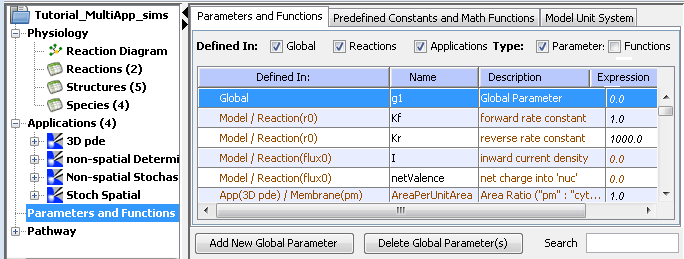

# Parameters and Functions Overview

The Virtual Cell allows the user to define parameters that can be used in the modeling of complex
cell processes. User-defined parameters can be added at the physiology level either as **global**
parameters or as **reaction** parameters. There are other predefined parameters such as species
initial conditions or reaction rates for the different kinetic types that are generated as the model
is being developed, for which the user has to provide values. The parameter values can be numeric or
expressions involving other allowable variables in the model. Parameter values that are expressions
are referred to as **Functions** in the Virtual Cell.

**Viewing/Editing Parameters and Functions**

Clicking **Mathematics & Units** in the 'Navigation' panel tree structure opens the model's
[Parameters and Functions](ParametersAndFunctions.md) in the 'View' panel on the right: one table of
every parameter and function, the [predefined constants and math functions](PredefinedConstAndMathFns.md)
among them. Its **Filters** choose what the table lists, and its **Model Unit System...** button
opens the [Model Unit System](ModelUnits.md) window, which shows the model's units and chooses its
unit system.
