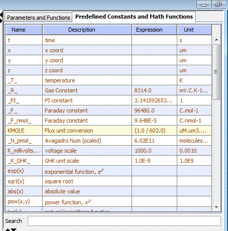

# Predefined Expressions

The Virtual Cell specifies a set of reserved symbols and constants and a subset of math functions
that can be used in expressions and computations.

Clicking **Predefined Expressions** under **Mathematics & Units** in the 'Navigation' panel on the
left of a VCell document, or its tab in the 'View' panel on the right, displays a list of the
allowed VCell constants and math functions in a table. This table is not editable. The list of
symbols, constants and functions are classified as follows:

**Reserved Symbols**

- **t** - time
- **x** - x coord
- **y** - y coord
- **z** - z coord

**Reserved Constants**

- **\_T\_** - temperature in degree Kelvin
- **\_PI\_** - PI constant = 3.1428571428
- **\_F\_** - Faraday constant = 9.648e4 Coloumb_per_mole
- **\_F_nmol\_** - Faraday constant = 9.648e-5 Coulomb_per_nano-mole
- **\_N_pmol\_** - Avagadro Number (scaled) = 6.02e11 molecules_per_pico-mole
- **\_K_GHK\_** - Goldman-Hodgkin-Katz unit scale = 1e-9
- **\_R\_** - Gas Constant = 8314.0 mVolts_Coulomb_per_Kelvin_per_mole
- **K_millivolts_per_volt** - voltage scale = 1000

**Math Functions**

- **abs(x)** - absolute value
- **acos(x)** - inverse cosine function
- **acosh(x)** - inverse hyperbolic cosine function
- **acot(x)** - inverse cotangent function
- **acoth(x)** - inverse hyperbolic cotangent function
- **acsc(x)** - inverse cosecant function
- **acsch(x)** - inverse hyperbolic cosecant function
- **asec(x)** - inverse secant
- **asech(x)** - inverse hyperbolic secant function
- **asin(x)** - inverse since function
- **asinh(x)** - inverse hyperbolic sine function
- **atan(x)** - inverse tangent function
- **atan2(x,y)** - similar to atan(y/x), except places the angle in the correct quadrant
- **atanh(x)** - inverse hyperbolic tangent function
- **ceil(x)** - smallest integral value not less than x
- **cos(x)** - cosine function
- **cosh(x)** - hyperbolic cosine function
- **cot(x)** - cotangent function
- **coth(x)** - hyperbolic cotangent function
- **csc(x)** - cosecant function
- **csch(x)** - hyperbolic cosecant function
- **exp(x)** - exponential function, e^x
- **factorial(x)** - factorial function x!
- **floor(x)** - largest integral value not greater than x
- **log(x)** - natural logarithmic function
- **log10(x)** - base 10 logarithmic function
- **max(x,y)** - maximum of x and y
- **min(x,y)** - minimum of x and y
- **pow(x,y)** - power function, x^y
- **sec(x)** - secant function
- **sech(x)** - hyperbolic secant function
- **sin(x)** - sine function
- **sinh(x)** - hyperbolic sine function
- **sqrt(x)** - square root
- **tan(x)** - tagent function
- **tanh(x)** - hyperbolic tangent function

**Special** [Output Function](../BioModelApplications/Simulations/output_functions.md) **Operators**

- **vcGrad(variableName,{'x','y','z','m'})** - Spatial gradient, non-membrane variable name,
  'x','y','z' directions or 'm' magnitude. (include single quotes ' ')
