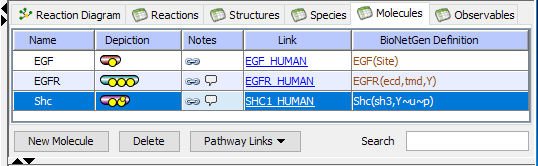

# Molecules Table

**Molecules** are the principal component of rule-based model specification. They are used to create
[Species](SpeciesTabView.md) and to define [Reaction Rules](ReactTabView.md) and
[Observables](Observables.md). Molecules are structured objects comprised of **sites** that can bind
other sites, either within a single molecule or between molecules. **Sites** typically represent
physical parts (e.g. domains) of proteins. **Sites** may also be associated with a list of states,
intended to represent states or properties of the site, e.g. phosphorylation status or activation
status.

The Molecules Table displays:

- Molecule **name** that can be edited
- **Molecular depiction** with different color ovals representing molecules. Circular elements
  represent specific sites on the molecule, and a small circle associated with a site denotes
  multiple possible states for the site.
- **Notes** show a link symbol if there are annotated links to database entries and a text bubble if
  there are text annotations related to the molecule. Double-click the text bubble to view the
  [Annotations Properties Pane](../PropertiesPanes/PP_Annotations.md) for the molecule.
- **Links** show links to pathway items (see
  [Biology Pathways](../BiologicalPathways/PathwayOverview.md)). Double-click on that link to
  navigate to the Pathway Diagram.
- [BioNetGen](../Appendix/Definitions.md#bionetgen) Definition gives the BioNetGen Language (bngl)
  description of the molecule.

**Select** a molecule to view the [Molecule Properties Pane](../PropertiesPanes/PP_Molecules.md) to
the bottom right of the workspace to edit the molecule.

**New Molecule** creates a new molecule with a default name **MT'number'**, and also creates a new
[observable](Observables.md) with the default name **O'number'\_MT'number'\_tot.** The Observable
tracks the amounts of all instances of the molecule in all species. (Note that if the Molecule is
conserved (i.e. not synthesized or degraded), then the observable **Molecule_tot** will be
conserved, which is one possible verification of model consistency.)

**Specify Molecular Details** in the [Molecule Properties Pane](../PropertiesPanes/PP_Molecules.md)
in the bottom right of the work space for a selected Molecule. The molecule name can be edited
directly in the Molecules table.

**Delete** molecules by selecting the row and using the Delete button below the table. A molecule
will not be deleted if it is used elsewhere in the model. Because a molecule_tot observable is
automatically created for each molecule, you must first delete the observable before you can delete
the molecule.

**Pathway Links** opens a table to [Edit Pathway Links](PathLink.md).

**Search** the list of molecules by entering a name or an element of molecular structure in the
Search box below the table.

**Add or Edit Annotations** using the [Annotations](../PropertiesPanes/PP_Annotations.md) tab in the
Properties Pane.
