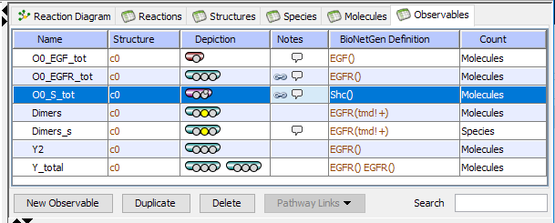

# Observables Table

**Observables** are used to specify the outputs of a model; they are functions of the total
population of multiple species that share a set of properties. For example, to simulate the tyrosine
phosphorylation level of a particular protein, the **Observable** would be a function describing the
total amount of all species containing the phosphorylated form of the protein.

- Each Observable consists of one or more **Species Patterns**. Each observable selects species that
  match at least one of the species patterns (not both).
- A species pattern defines common features of multiple species, and consists of one or more of the
  [molecules](Molecules.md) that compose a species. Molecules may or may not be explicitly
  connected, but must be present in every species selected by the species pattern. Sites that have
  multiple possible states are depicted with a small ball above the site.
- Each molecule within a species pattern may have sites left undefined. If a site does not have
  defined states (where states are possible) and the site can be in the bound or unbound state, the
  site is colored light grey.
- An observable may identify sites with a defined binding state - i.e. the function can explicitly
  identify a site bound to another site, a site unbound, or a site bound to an unspecified (i.e. any
  other) site; in this case the site is colored yellow with a bond drawn as a colored line if one
  exists.
- A site that has a defined state is always shown in yellow.

The Observables Table displays

- The **Name** of Observable (can be edited).
- The **Structure** indicates where the species selected by an Observable are located .
- The **Depiction** of each Observable. Grey circles within each molecular shape denote molecular
  sites, small grey circles associated with the site denote that this site has possible states. If
  the Observable selects one possible state of a site with multiple possible states, the small
  circle is colored yellow. If the Observable selects a specific bond for a binding site, the site
  is colored yellow.
- **Notes** show a link icon if there are annotated links to database entries or a text bubble if
  there are text annotations for the reaction. Double click in the Notes column to show the
  [Annotations Properties](../PropertiesPanes/PP_Annotations.md) Pane for a reaction.
- A [BioNetGen](../Appendix/Definitions.md#bionetgen) definition. The definition cannot be edited
  but can be searched.
- The **Count** of either **Molecules** or **Species**. The count of molecules is a **weighted** sum
  of the population levels of all the species that match the pattern(s) defined in the observable.
  Each amount is multiplied by the number of times that the species is matched by the pattern(s).
  For example, a species that consists of two instances of a receptor (i.e. a dimer) is counted
  twice. The count of species is an **unweighted** sum of the amounts the species that match the
  pattern(s) define by the observable. For example, a species that has two instances of a receptor
  is counted once.

**Edit** an Observable name within the table. The function defined by the observable and its
properties are specified in the [Observables Properties Pane](../PropertiesPanes/PP_Observables.md)
in the bottom right of the overall workspace.

**Filter** the list of observables using the Search Box to enter a name or any part of the
observable composition.

**Delete** an observable by selecting and using the "Delete" button below the table.

**Add or Edit Annotations** using the [Annotations](../PropertiesPanes/PP_Annotations.md) tab in the
Properties Pane.
