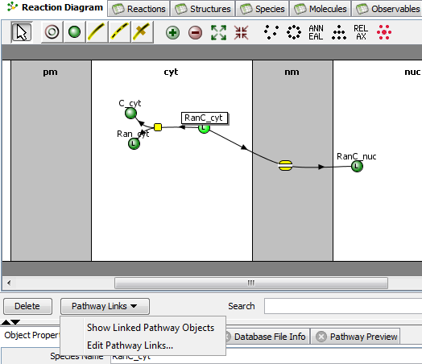
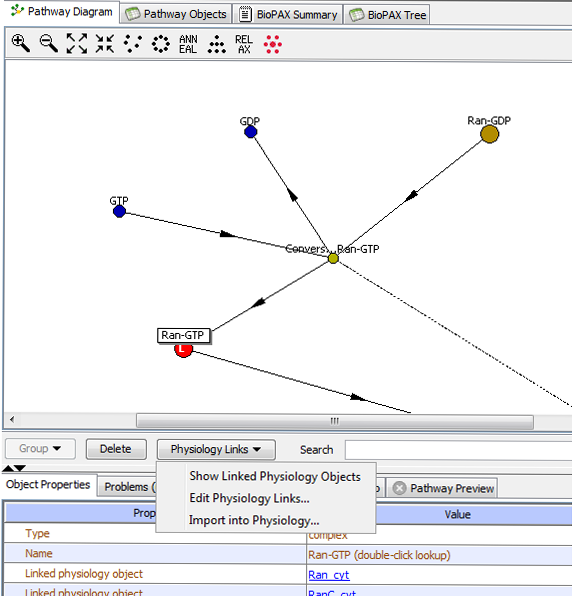
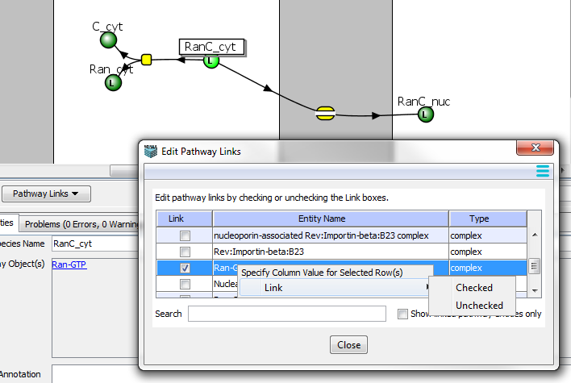

# Pathway Links

Objects in the Physiology (species and reactions) and pathway entities in a Pathway Model can be
linked. The linked objects are marked with a letter 'L'.

Selecting a single species or a single reaction in the Reaction Diagram, Reactions Table or Species
Table enables a **Pathway Links** button.

If a species or reaction is already linked to a pathway object, there are multiple ways to see
**Linked pathways objects**.

- Double click on the blue underlined link that appears in the **Link** column in the **Reactions**
  and **Species** tables or under **Linked Pathway Objects** in the **Reaction Diagram**.
  Annotations and Pathways can be viewed in the Reaction and Species **Object Properties**pane.
- Select **Show Linked Pathway Objects** under the **Pathway Links** menu.

In either case a [Pathway Diagram](../BiologicalPathways/PathwayDiagram/PathwayDiagramView.md) view
appear in the main model workspace. Linked objects appear in red in the pathway diagram.

**/Add or edit Pathway Links.** by selecting **Physiology Links -> Edit Physiology Links...** to
initiate a dialog box with the list of all objects in the Biomodel (physical entities for a species
or interactions for a reaction). Create new links or delete existing links by checking/unchecking
the checkbox in the table of objects in the dialog box. A Search field is provided for filtering the
list of objects.

