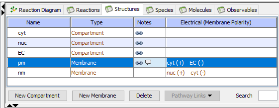

# Physiology Structures Tabular View

The structure table lists structures and their properties (Name, Type of structure, Notes,
Electrical properties). Items in black can be edited; items that cannot be edited are in brown.

**Add a new volume structure** using the "Add New Compartment" button below the table.

**Add a new membrane structure** using the "Add New Membrane" button below the table.

**Edit** the structure name by double clicking in the table, or within the
[Properties Pane](../PropertiesPanes/PP_Structures.md).

**Delete** structures by selecting one or more structures and using the "Delete" button. Structures
that contain species cannot be deleted.

**Notes** show a link icon if there are annotated links to database entries or a text bubble if
there are text annotations for the reaction. Double click in the Notes column to show the
[Annotations Properties](../PropertiesPanes/PP_Annotations.md) Pane for a reaction.

The bottom pane of the window displays the
[Structure Properties](../PropertiesPanes/PP_Structures.md) depending on on the current selection.
