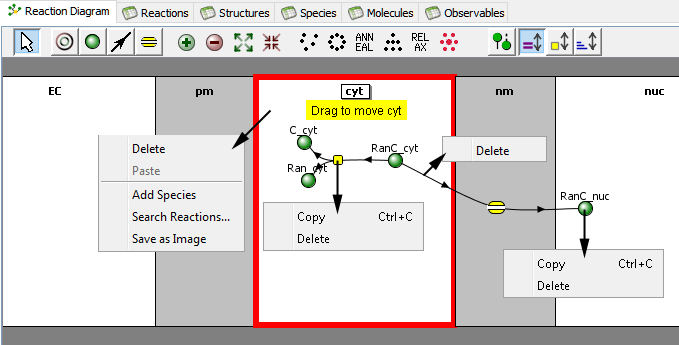
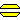
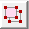
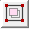
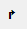

# Reactions Diagram

The reactions diagram shows a bipartite graph of the phsyiological components of the model; this
diagram can be used to construct the underlying physiology for the Biomodel. It consists of
[species](../Appendix/Definitions.md#species) (**green** balls for species without
[molecular details](Molecules.md), or **blue** balls for species with
[molecular details](Molecules.md)) and [reaction](../Appendix/Definitions.md#reactions)
nodes(**yellow** squares), each within the appropriate compartment. Lines connect species that
participate in a reaction. In rule-based models, species patterns representing reactants and
products defined within rules are depicted with ovals around balls (molecules) of various colors.

Structures are depicted as connected rectangles within the workspace. Lines each connect one species
(green or blue balls) with one reaction (yellow square): solid lines with arrows denote reactants
and products with the arrow indicating the direction of the forward reaction; dashed lines denote
catalysts as defined by the reaction kinetics. Stoichiometric coefficients, if different from one,
are displayed next to the appropriate lines. Toolbars above and below the diagram provide tools to
edit the diagram.

When a single object in the graph is selected, properties of that object are displayed in the
Properties Pane in the bottom right pane of the window. Kinetics of reactions and fluxes are edited
in this pane, as described in the [reaction](../PropertiesPanes/PP_Reactions.md) and the
[membrane flux](../PropertiesPanes/PP_MemFlux.md) Properties Pane Help.

**Create and edit the Physiology** using the tools in the toolbar above the graph; selecting the
tool alters the function of the mouse to edit different components of the physiology as described
below.

The **Selection** tool selects Species (graph nodes), connecting lines (edges) or reactions by mouse
click, or drag the mouse to select multiple components. Add to the selection with shift and left
mouse button, toggle with control and left mouse button.

The **Structure** tool inserts a new structure by clicking between existing structures or appending
new structures to the ends. Dashed vertical lines appear on the reaction diagram to indicate where
structures can be added. Hovering with the mouse turns the dashed lines green with instructions to
**'click to insert structure'**. When clicked a menu appears to **'Add Compartment** to add a volume
compartment or **'Add Membrane"** to add a membrane compartment.

**Move a structure** using the 'Selection tool'. Click and drag on the **structure name** to enable
**drag to move**; releasing the mouse over any set of vertical dashed lines moves the structure and
contents to the new location.

The **Species** tool adds new species by clicking within a structure. Names automatically generated
for species can be edited in the [species property pane](../PropertiesPanes/PP_Species.md). New
species are created without molecular details and appear **green**; species change to **blue** if
the molecular composition of the species is specified using the
[species properties pane](../PropertiesPanes/PP_Species.md). A species can only be assigned to one
compartment; so, for example, calcium in the extracellular space is a different species from calcium
in the cytoplasm of a cell, and each must have a unique name.

The **Reaction** tool creates reactants/products of a reaction or membrane flux, connecting them
with a line in the graph. For non-flux reactions, drag the mouse to assign reactant or product roles
by connecting species or reactions. The direction of the drag determines whether a reactant or
product role is assigned (e.g. dragging from species to reaction creates a reactant role, dragging
from reaction to species creates a product role). **Create a reaction** by dragging from species to
species. Dragging in open space automatically creates new reactant and product species.

**Create a destruction reaction** by dragging from an existing species to open space. **Make a
creation reaction**, by dragging from open space to an existing species. **Create an intermediary
species** by dragging from reaction to reaction (or open space).

If a reaction is drawn from species in one volume compartment to a different volume compartment, the
reaction is placed in the membrane. Reactions between species in different volume compartments is
allowed in nonspatial applications but act as source or sink reactions in spatial applications and
invoke a warning when a spatial application is created.

**Enter kinetics** for reactions in the Object Properties pane when the reaction is selected, as
described in the [Reaction](../PropertiesPanes/PP_Reactions.md) Properties Pane Help.

The **Membrane Flux** tool creates a membrane flux by clicking in a membrane structure. Add flux
participants by selecting the 'reaction tool' and dragging, first from an existing species to the
newly created flux component then click and drag again from the flux component to another existing
species. Dragging to or from open space automatically creates a new species.

**Enter kinetics** of fluxes in the Object Properties pane when the Membrane Flux is selected, as
described in the [membrane flux](../PropertiesPanes/PP_MemFlux.md) Properties Pane Help.

buttons vary the display magnification of the reaction diagram.

The **layout buttons** automatically arrange the components (graph elements) by different
algorithms. These include (from left to right) random, within an ellipse within each structure, so
that most lines point downward, to make lines shorter and more similar to each other in lengths, and
to place nodes more evenly across each structure.

Buttons to the right of the layout buttons alter the depiction of species and reactions in the
diagram and are particularly useful for **Rule-based models**.

Depicts reaction rules individually; species are repeated for each rule in which they participate.
Only appears when a rule-based model is opened.

Depicts reaction rules organized by individual species. Only appears when a rule-based model is
opened.

Toggles all catalysts to be colored distinct from reactant and product species.

Depicts all species as the same size.

Depicts species as different sizes based on the number of reactions they are involved in.

Depicts species as different sizes based on the number of molecules that make up the species.

Allows the Reaction Diagram pane to float free from the rest of the VCell workspace. This can be
useful when looking at simulation results or parameters, for example. Closing the Reaction diagram
window returns it to the VCell workspace.

The mouse popup menu provides several functions depending on the current selection
(structures,reactions,species):

- **Save As Image** saves a snapshot of the whole reaction diagram to file. The width of the image
  in pixels needs to be specified. Zooming up the reaction diagram view increases the resolution of
  the image.
- **Search Reactions** searches for reactions by reaction name or species in all models accessible
  to the user, either private, shared or public models.
- **Delete** or **Copy** selected reactions and species.
- **Paste** copied reactions and species into selected structures.

The **delete button** deletes selected elements. Delete will fail if a species is connected to a
reaction or flux; you must first delete the reaction or disconnect the species from the reaction.

The [Pathway Links](PathLink.md) button allows the user to follow links from model elements
(species, reactions or fluxes) to pathway elements, or to edit pathway links.

The **search** text field allows the user to select multiple components that have a similar name.

The bottom pane of the window displays the **Object Properties** for the selected
[reaction](../PropertiesPanes/PP_Reactions.md), [membrane flux](../PropertiesPanes/PP_MemFlux.md),
[species](../PropertiesPanes/PP_Species.md),
[stoichiometry](../PropertiesPanes/PP_Stoichiometries.md) or
[structure](../PropertiesPanes/PP_Structures.md) properties. **Enter kinetics** for reactions and
membrane fluxes in the selected Object Properties.
