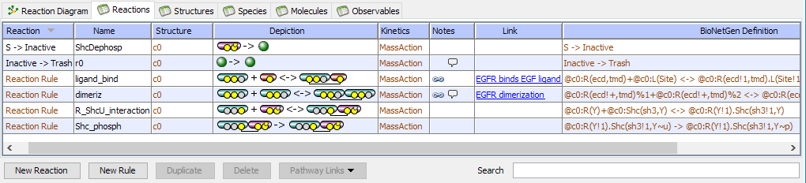
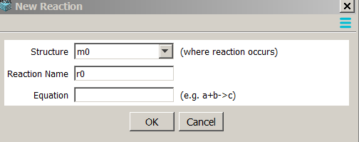

# Reactions Table

A table of reactions can be used to create and edit
[reactions](../Appendix/Definitions.md#reactions), membrane fluxes and
[reaction rules](../Appendix/Definitions.md#reaction-rules).

The Reactions table has several columns:

- **Reaction** lists either a reaction (or flux) that can be edited in place, or "Reaction Rule"
  text that cannot be edited. A Reaction Rule can only be edited by selecting the row to open the
  [Reaction Rules Properties](../PropertiesPanes/PP_ReactionRulesEditor.md) pane.
- **Name** lists the reaction name; reaction names are generated automatically as "r_number" but can
  be edited to any text (without spaces).
- **Structure** lists the [structure](../Appendix/Definitions.md#structure) where the reaction, flux
  or reaction rule occurs.
- **Depiction** shows the molecular details of the reactants and products. Species that do not have
  molecular details are depicted as green balls. For reactions, molecular details of species appear
  only if they are first specified in the [Species](SpeciesTabView.md) tab. For reaction rules,
  reactant and product molecular details are specified below in the
  [Reaction Rules Properties](../PropertiesPanes/PP_ReactionRulesEditor.md) pane. For species with
  molecular details, yellow sites denote that the state of the site is specified in the Reaction
  Rule (e.g. bound/unbound, phosphorylated/unphosphorylated), grey sites are undefined in the
  Reaction Rule. Green sites indicate that multiple states are specified.
- **Kinetics** list the kinetic type for the reaction; select the reaction and edit in the
  properties pane below. For reaction rules, only Mass Action kinetics are allowed.
- **BioNetGen Definition** provides the BioNetGen Language (BNGL) string that encodes the rule. It
  cannot be edited but can be searched.
- **Notes** show a link icon if there are annotated links to database entries or a text bubble if
  there are text annotations for the reaction. Double click in the Notes column to show the
  [Annotations Properties](../PropertiesPanes/PP_Annotations.md) Pane for a reaction.
- **Links** show links to pathway items (see
  [Biology Pathways](../BiologicalPathways/PathwayOverview.md)); double click on that link to
  navigate to the Pathway Diagram.

The bottom pane of the window displays a
[Reaction Properties pane](../PropertiesPanes/PP_Reactions.md),
[Membrane Flux Properties pane](../PropertiesPanes/PP_MemFlux.md), or
[Reaction Rules Properties pane](../PropertiesPanes/PP_ReactionRulesEditor.md), depending on the
current selection.

Buttons below the table are used to create or delete reactions or rules Buttons related to Reaction
Rules only appear if [Molecules](../Appendix/Definitions.md#molecule) have been created in the
model. **New Reaction** calls a popup menu to add a new reaction or flux. Select the structure where
the reaction occurs from the Structure drop-down menu, define a name for the reaction and type the
reaction using the format "a+b->c" where a and b, etc. are reactants and c, etc are products.
Numbers before a species name are used to indicate stoichiometry. If a, b, etc have not been
previously created, they are created automatically within the structure where the reaction occurs.

**New Rule** opens the [reaction rule editor](../PropertiesPanes/PP_ReactionRulesEditor.md) in the
properties pane below, where rules must be created and edited.

**Edit** kinetic laws by selecting a row in the table and editing the
[Reaction Properties pane](../PropertiesPanes/PP_Reactions.md),
[Flux Properties pane](../PropertiesPanes/PP_MemFlux.md) or
[Rule Editor](../PropertiesPanes/PP_ReactionRulesEditor.md) as appropriate.

**Add or Edit Annotations** using the [Annotations](../PropertiesPanes/PP_Annotations.md) tab in the
Properties Pane.

**Delete** a reaction, flux or rule after selecting a row or rows.

**Duplicate** creates an exact copy of highlighted rule with the new name "oldname_0".

The [Pathway Links](PathLink.md) button is used to identify reactions within
[Pathway Commons](../Appendix/Definitions.md#pathway-commons) Database to link to the reaction.
Pathway Links are not available for reaction rules at this time.

**Search** the list of reactions and reaction rules using the Search Box to enter reaction name,
structure, or any part of a BNGL string.
