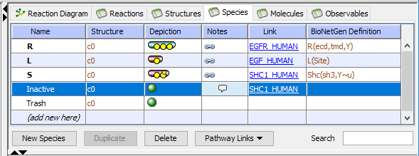

# Species Table

**Species** are used to create variables (molecular species) in
[reactions](../Appendix/Definitions.md#reactions) and fluxes and can exist in both
[membranes](../Appendix/Definitions.md#membrane) and
[volume compartments](../Appendix/Definitions.md#compartments) (volumes). Species are unique pools
of molecules within a single structure; if the same species is copied to a different structure, the
structure name is appended to the species name to retain a unique identifier, e.g.
species_structure. A species is depicted in the [Reaction Diagram](ReactDiagView.md) as a green
shape.

In [rule-based models](../Appendix/Definitions.md#rule-based), molecular details must be specified
for all species. Species are composed of [molecules](Molecules.md) with bonds that connect binding
sites. If the molecule has multiple states, each state of the molecule (at each site) must be
specified - otherwise the species would represent a pool of different chemical entities and would
not be valid. Species with molecular details can be used in any reaction networt. In rule-based
models a species serves as a seed species when [rule-based](../Appendix/Definitions.md#rule-based)
models: they are either used as starting set of species to generating a network (using
[BioNetGen](../Appendix/Definitions.md#bionetgen)), or is used as part of an initial set of species
for stochastic [network-free](../Appendix/Definitions.md#networkfree) simulations performed using
the (using [NFSim](../Appendix/Definitions.md#nfsim) solver).

The Species Tab has several columns:

- The species **Name**. New species are automatically named s_number. When a BNGL file is imported
  species names are automatically generated. The name can be edited in the column.
- The [structure](../Appendix/Definitions.md#structure) that contains the species.
- **Depiction** depicts the molecular structure of the species. Species without molecular details
  appear as green shapes. Different molecules comprising a species appear as differently colored
  shapes, connect by bonds. Sites that have states are marked with a yellow dot. The states of sites
  are omitted for clarity.
- **Notes** show a link icon if there are annotated links to database entries or a text bubble if
  there are text annotations for the species. Double click in the Notes column to show the
  [Annotations Properties](../PropertiesPanes/PP_Annotations.md) Pane for a species.
- **Links** show links to pathway items (see
  [Biology Pathways](../BiologicalPathways/PathwayOverview.md)); double click on that link to
  navigate to the Pathway Diagram.
- **BioNetGen Definition** provides a BNGL string for species with molecular detail. The two ends of
  the same bond will have the same color font. This field is cannot be edited but is searchable.

**Edit** molecular details of species in the
[Species Properties pane](../PropertiesPanes/PP_Species.md) in the lower window.

**Filter** the list of species using the Search Box to enter a species name or a structure name.

**Delete** species by highlighting and using the "Delete" button below the table.

If you wish to use [Pathways Commons](../BiologicalPathways/PathwayOverview.md) data, select the
species and use the [Pathway Links](PathLink.md) button.

**Add or Edit Annotations** using the [Annotations](../PropertiesPanes/PP_Annotations.md) tab in the
Properties Pane.
