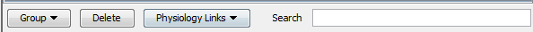
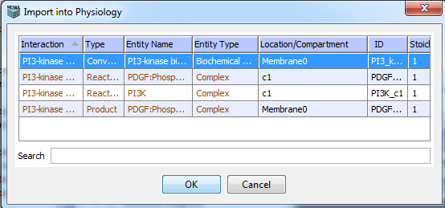
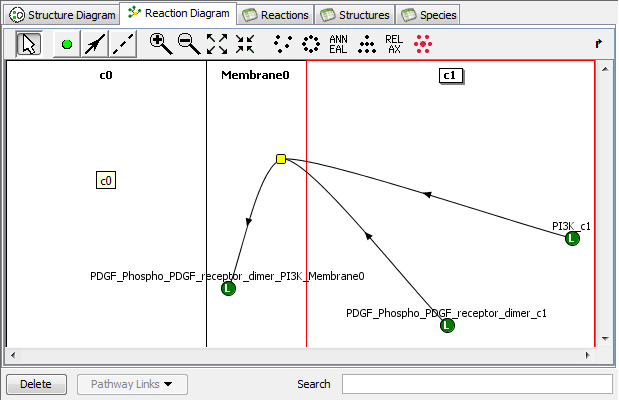
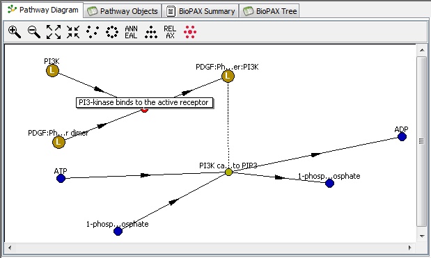
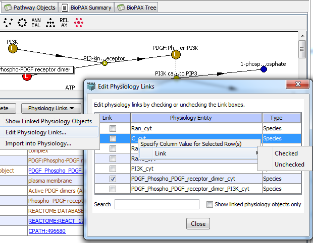
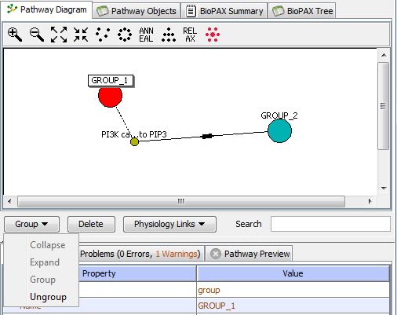
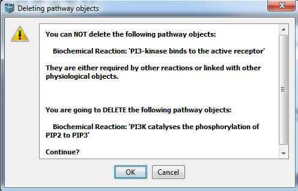

# Entities Management Toolbar

The buttons shown in this toolbar allow the user to perform various useful operations on selected
entities within the [Pathway Diagram](../BiologicalPathways/PathwayDiagram/PathwayDiagramView.md)
view and the [Pathway Objects](../BiologicalPathways/PathwayObjects/PathwayObjectsView.md) table
view.

This toolbar shows buttons allowing group, delete and link operations on selected entities. A
**Search** feature filters entities by string.

The user can perform various operations upon these entities, either on individually selected
entities or multiple selected entities.

**Importing.** Single / multiple pathway entities can be imported into Physiology. Following this
process, new species and/or reactions will be created within the BioModel. A permanent link will
preserve the relationship between the BioModel and the Pathway entities. To do this, select one or
more pathway entities and press the **Physiology Links** button, then use the option **Import into
physiology...** In the Dialog box the user is allowed to edit the values for the compartment, ID and
stoichiometric coefficient. The Location/Compartment column provides the drop-down list of
compartments specified in Physiology. If no compartments are specified, it shows the default
compartment c0. In the example below, the reactants are located in c1 while the product is located
on the membrane. The reaction itself must be treated as a membrane reaction because at least one
reaction participant is located on the membrane. ID is the name that will be assigned to the species
or reaction in the Physiology.

Once that step is finished the imported entities are displayed within the
[Reaction Diagram View](../Physiology/ReactDiagView.md) and show a small 'L' mark inside nodes,
indicating their linked status.

Returning to the Pathway Diagram View it can be noticed that the linked entities display a small 'L'
mark within their circle representation, indicating their linked status.

**Editing Physiology Links.** The user can link/unlink every pathway object to every object in the
physiology (reactions or species). Selecting **Physiology Links -> Edit Physiology Links...** will
start a dialog box with the list of all objects that can be linked (species for a physical entity or
reactions for an interaction). The user can create new links or deleted existing links by
checking/unchecking checkboxes in the dialog. The search field is provided for easy filtering.

**Grouping.** Selecting multiple entities either in a
[Pathway Diagram](../BiologicalPathways/PathwayDiagram/PathwayDiagramView.md) view or in a
[Pathway Objects](../BiologicalPathways/PathwayObjects/PathwayObjectsView.md) view enables a
**Group** button. Grouping reduces clutter and allows the user to focus on the significant parts of
the view. Consider the view below:

The user may choose to group all the linked items (those marked with a 'L' letter) under a group and
all the participants of the other reaction under a second group. The entities can be selected either
in a [Pathway Diagram](../BiologicalPathways/PathwayDiagram/PathwayDiagramView.md) view or in a
[Pathway Objects](../BiologicalPathways/PathwayObjects/PathwayObjectsView.md) view. The result will
look as follows:

Existing groups can be grouped in even larger groups. Also groups can be broken down into their
original subcomponents using the Ungroup option.

**Deleting.** Single / multiple entities can be deleted from the view using the **Delete Selected**
button. Note that linked entities cannot be deleted as long as the link exists. In the case of
selections where some entities can be deleted and some others can not, a warning dialog box will
display pertinent information. In the example below the user tried to delete two reactions one of
which is linked.

