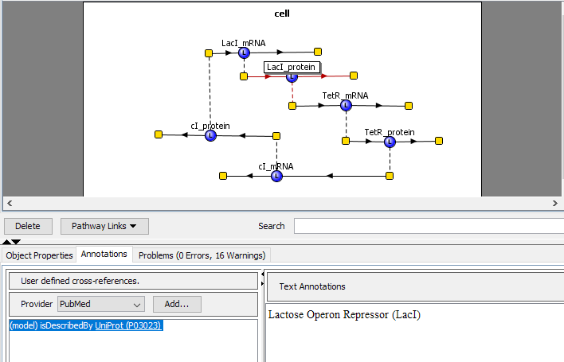
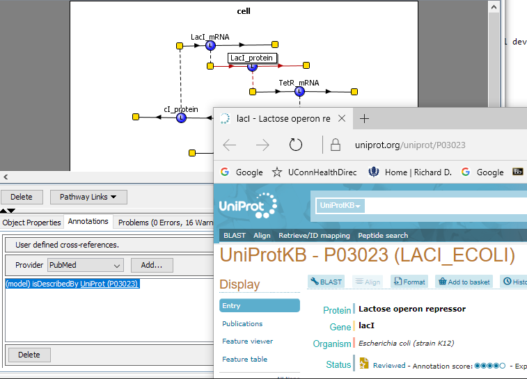
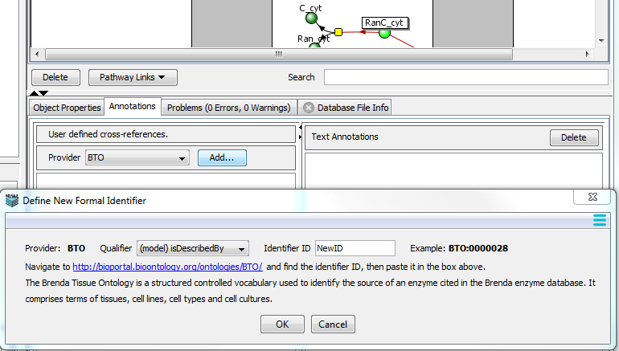

# Annotations Panel

Each element in a VCell BioModel, as well as the BioModel itself, can be annotated with either
unique identifiers or plain text information. Annotations are created and displayed in the
**Annotations Property Pane**.

- **Select** a VCell element (e.g. species or reaction) to highlight it, then **select** the
  Annotations tab in the lower right Properties Panes of the VCell workspace to view any unique
  identifiers (left panel) or text (right panel) that have been associated with the VCell element.

- Follow the **annotation link** by double click on the underlined link portion of the annotation.

  

- **Add** new unique identifiers using the drop down menu to select a supported provider. Double
  click the provider link to go to the provider web site to search for the appropriate provider. Add
  the identifier to the annotation pane using the exact format shown in the example. Supported
  identity providers are listed in the [Appendix](../Appendix/AnnotationProviders.md)
- 

- **Type or Paste** text annotations into the text field
- **Model Annotations** are entered in the same way when the loaded Model name in the top level of
  the VCell [Navigation Menu](../Introduction/GeneralNavAndWinSetup.md) is selected.
