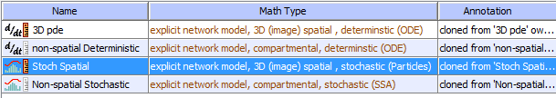
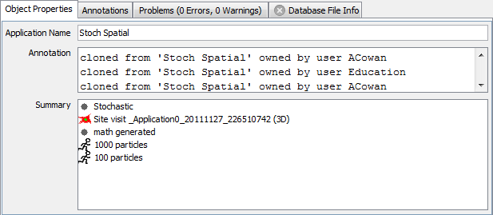

# Application Properties Pane

Selecting the **Applications (count)** main tree list item from the upper left document window panel
of a BioModel will display a list of 'Applications' in the upper right panel of the document window.

Selecting an 'Application' from the displayed list will show an 'Object Properties' panel in the
lower right of the document window.

- **Application Name** editable text that uniquely identifies the application.
- **Annotation** editable 'user notes' that are stored with each application within a model.
- **Summary** contains application **Type** (e.g. deterministic,stochastic), **Geometry** (either
  'compartmental' or 'geometry name' and dimension (1D,2D,3D)), **math generated** flag identifying
  proper math generation, **Simulation names** (list of simulations contained within the
  application).
