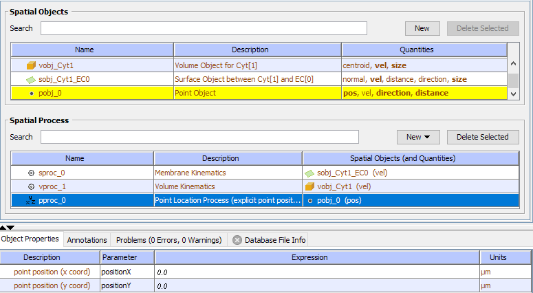

# Point Location Process Kinematics Properties Pane

The Point Location Kinematics Process Properties Pane is used to display and edit properties of a
kinematic process in which the position of the point object is explicitly defined.

When a **Point Location Process** is selected an expression can be entered or edited that explicitly
defines the position of the point in x and y. (z is not used because the current solver is limited
to 2D)

**Add or Edit** an expression in the Expression column in the table. The expression can use any of
the properties previously selected for that object in the
[Point Object Properties Pane](PP_KinematicsPointObject.md). When entering an expression, a dropdown
box will appear to select enabled properties as you type, or press the space bar to view the
dropdown menu of all available object properties enabled for the velocity expression.

Once you entered an Expression for the locations in x and y, if you later uncheck the box that
enables that property in the Point Object Property Pane, an error symbol will appear next to the
Object in the **Object Table**, with an explanation for the error displayed in the
[Problems](PP_Problems.md) tab of the Properties Pane.

Note that the size of the computational domain should be large enough to contain the object for the
entire time course of any simulations. The computational domain can be adjusted using the **Edit
Domain** button in the **Geometry Definition Tab** of the
[Geometry](../BioModelApplications/Geometry/GeometryOverview.md) workspace.
