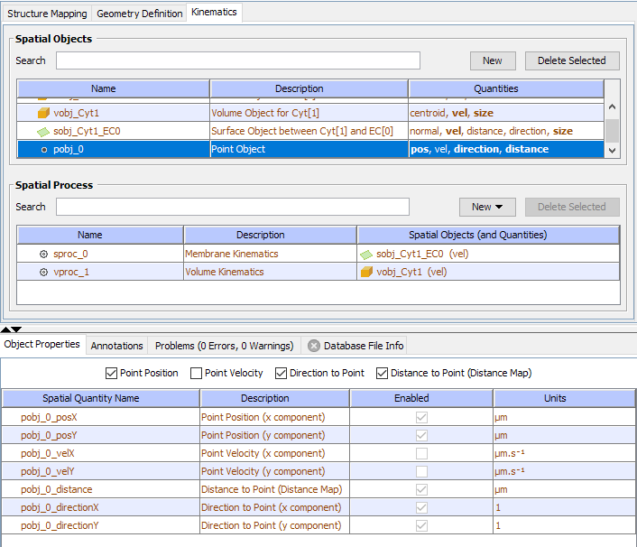

# Point Object Kinematics Properties Pane

When a **Spatial Object** is selected, Object Properties are displayed for that Object. The Point
Object Kinematics Properties Pane is used to display and enable properties that will be used to
describe the point's kinematic process.

Use the **check box** to enable those properties that will be used to describe the kinematics for
the selected object. The available properties are:

- **Point Position** to specify the x and y position. (z is not used because the current solver is
  limited to 2D)
- **Point Velocity** to specify the x and y components of the point velocity.
- **Distance to Point** to specify the distance from points in the computational box to the point
  object.
- **Direction to Point** to specify the x and y direction from points in the computational box to
  the point object.
