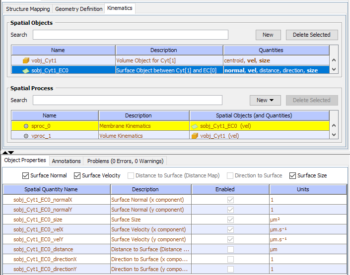

# Surface Object Kinematics Properties Pane

When a **Spatial Object** is selected, Object Properties are displayed for that Object. The Surface
Object Kinematics Properties Pane is used to display and enable properties that will be used to
describe the surface's kinematic process.

Use the **check box** to enable those properties that will be used to describe the kinematics for
the selected object.

When a **Surface Object** is selected, the table displays

- **Surface Normal** to specify the x and y component of the normal to the surface. (z is not used
  because the current solver is limited to 2D)
- **Surface Velocity** to specify the x and y components of the surface velocity.
- **Distance to Surface** to specify the shortest distance from a point object to the surface.
  Currently unavailable.
- **Direction to Surface** to specify the x and y direction from a point object to the surface.
  Currently unavailable.
- **Surface Size** to specify the surface area.
