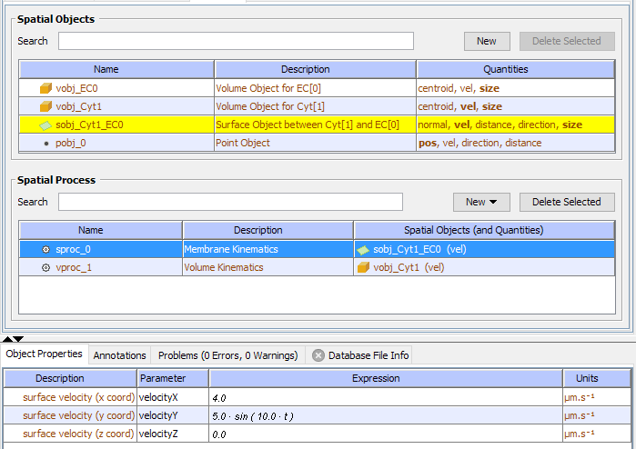

# Surface Process Kinematics Properties Pane

The Surface Process Kinematics Properties Pane is used to display and edit properties of a kinematic
process involving a surface object.

When a **Surface Process** is selected an expression can be entered or edited for the surface
velocity.

**Add or Edit** an expression in the Expression column in the table. The expression can use any of
the properties previously enabled for that object in the
[Surface Object Kinematics Properties Pane](PP_KinematicsSurfaceObject.md). When entering an
expression, a dropdown box will appear to select enabled properties as you type, or press the space
bar to view the dropdown menu of all available object properties enabled for the velocity
expression.

Once you enter an expression for the surface velocity, if you later uncheck the box that enables
that property in the Surface Object Property Pane, an error symbol will appear next to the Object in
the **Object Table**, with an explanation for the error displayed in the [Problems](PP_Problems.md)
tab of the Properties Pane.

Note that the size of the computational domain must be large enough to contain the object for the
entire time course of any simulations. The computational domain can be adjusted in using the **Edit
Domain** button in the **Geometry Definition Tab** of the
[Geometry](../BioModelApplications/Geometry/GeometryOverview.md) workspace.
