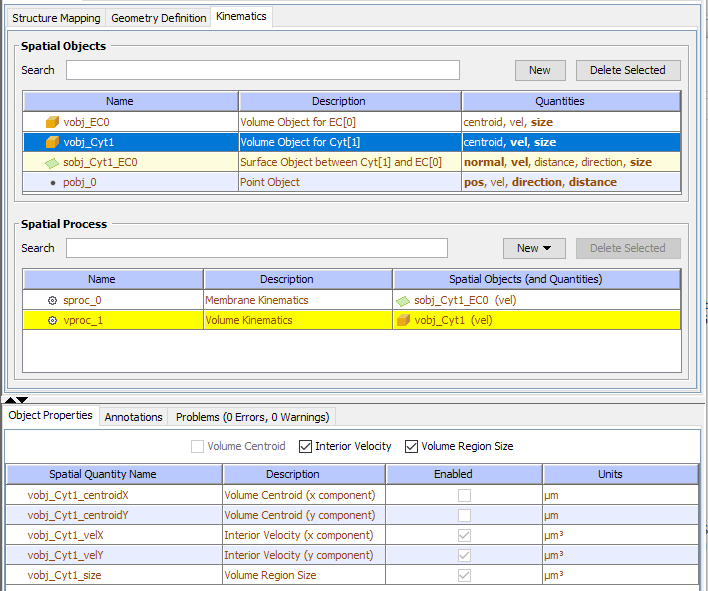

# Volume Object Kinematics Properties Pane

When a **Spatial Objects** is selected, Object Properties are displayed for that Object. The Volume
Object Kinematics Properties Pane is used to display and enable those properties that will be used
to describe the surface's kinematic process.

Use the **check box** to enable properties that will be used to describe the kinematics for the
selected object. The available properties are:

- **Volume Centroid** to specify the centroid x and y position. (the current solver is limited to
  2D) This property is currently not available to use.
- **Interior Velocity** to specify the x and y velocity components.
- **Volume Regions Size** to specify the size (area in 2D) of the volume object
