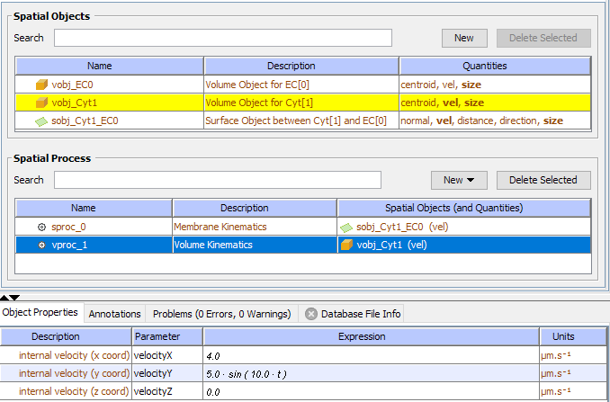

# Volume Process Kinematics Properties Pane

The Volume Process Kinematics Properties Pane is used to display and edit properties of a kinematic
process involving a volume object.

When a **Volume Process** is selected an expression can be entered or edited for the volume
velocity.

**Add or Edit** an expression in the Expression column in the table. The expression can use any of
the properties previously enabled for that object in the
[Volume Object Properties Pane](PP_KinematicsVolumeObject.md). When entering an expression, a drop
down box will appear to select enabled properties as you type, or press the space bar to view the
dropdown menu of all available object properties enabled for the velocity expression.

Once you enter an Expression for the internal Volume velocity, if you later uncheck the box that
enables that property in the Volume Object Property Pane, an error symbol will appear next to the
Object in the **Object Table**, with an explanation for the error displayed in the
[Problems](PP_Problems.md) tab of the Properties Pane.
