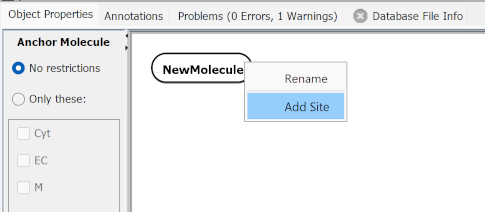
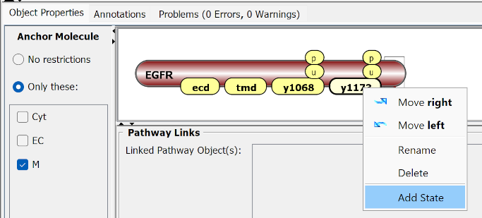

# Molecules Properties Pane

The Molecules Properties Pane includes a graphical editor used to specify sites within
[Molecules](../Physiology/Molecules.md) using drop-menus that appear upon right mouse click in the
**Object Properties** pane. An annotation box is also provided.

**Rename** a site or **add** a new site using the right mouse button to click on the molecule shape
and select from the drop-down menu.

**Add a state** to a site, **move** or **rename** a site by right click on molecule site and
selecting from the drop-down menu.

**Anchor** the molecule to a particular compartment or compartments within the physiology using the
radio buttons in the **Anchor Molecule** region of the Properties Pane.

- **No restrictions** places no restrictions on where the molecular type can exist; the molecule can
  participate in reactions with other molecules in any compartment. When a molecule with no
  restrictions binds to a molecule in a different compartment, the product molecule will reside
  within the compartment where the reaction occurs.
- **Structure Name** selects compartments where the molecule is anchored. Anchoring to a compartment
  or compartments prevents the molecule from participating in reactions that do not occur within the
  selected compartment(s).

Anchoring prevents unwanted reactions from occurring, e.g. to prevent a membrane molecule from
becoming a soluble molecule by binding to a cytosolic or extracellular molecule. Note that two
molecules that do not share an anchored compartment cannot interact with each other. For example, a
molecule anchored (restricted) to the membrane cannot bind to a molecule anchored (restricted) to
the cytosol. The molecule in the cytosol must either have no anchoring restrictions or be anchored
to both the membrane and the cytosol to participate in a reaction with a membrane-anchored molecule,
and the reaction occurs in the membrane compartment. The product of the binding reaction in this
example becomes a membrane-anchored molecule. Note that multiple anchors can be applied, but caution
is advised as this can lead to unexpected results.
