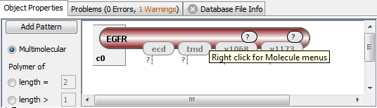
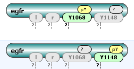
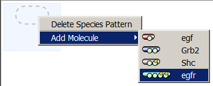
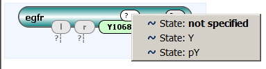
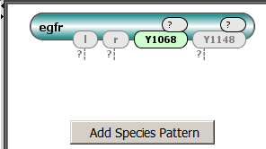
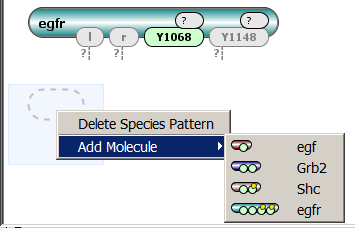
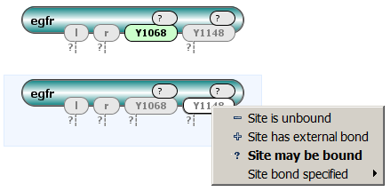

# Observable Properties Pane

**The Observables Properties** pane provides a graphical editor with drop-down menus to specify and
edit [Observables](../Physiology/Observables.md) used in
[Rule-Based](../Appendix/Definitions.md#rule-based) models.

An Observable consists of one or more **Species Patterns**. Each observable selects species that
match at least one of the species patterns. Observables are defined within each compartment within a
model.

A species pattern defines common features of multiple species, and consists of one or more of the
[molecules](../Physiology/Molecules.md) that compose a species. Molecules may or may not be
explicitly connected, but must be present in every species selected by the species pattern. Sites
that have multiple possible states are depicted with a smaller ball above the site. If the state of
a site with multiple states is specified in the observable, the smaller circle depicting multiple
states are colored yellow.

- Each molecule within a species pattern may have sites left undefined. If states of a site are
  possible but not defined and the site can be in the bound or unbound state, the site is colored
  light grey.
- An observable may identify sites with a defined binding state - i.e. the function can explicitly
  identify a site bound to another specified site, an unbound site, or a site bound to any other
  site; in this case the site is colored yellow with a bond drawn as a colored line if one exists.
- A site that has a defined state is always shown in yellow.

In the figure below, the Observable describes the total extent of phosphorylation of all EGFR
molecules. The first species pattern selects all species that have the tyrosine at position 1068
(Y1068) phosphorylated, the second species pattern selects all species that have the tyrosine at
position 1148 (Y1148) phosphorylated.

**Add an observable** using the **New Observable** button at the bottom of the main workspace. A
dotted shape will appear in the **Object Properties** tab of the properties pane. If the model has
more than one compartment, the compartment must be selected when the Observable is created, and only
molecules within the compartment can be added to the Observable. (Note that a parameter can be
created to sum Observables from different compartments if needed).

- **Add a molecule** to the pattern using a right click on the dotted shape and selecting a molecule
  to add to the species pattern from the drop-down menu.

  

- **Edit** the molecule site or state using a right click on the molecular site or state to bring up
  a drop-down menu.

- **Add another molecule** by right clicking in the window next to molecule.

  

- **Add another species pattern** using the **Add Pattern** button on the left side of the property
  pane or using a right click in the window below the first species pattern.

  

- **Specify the second species pattern** as for the first species pattern; a right click on the
  dotted shape will bring up a drop-down menu from which a molecule can be selected:

  

- **Edit the second species pattern** by right click on site to bring up the drop-down menu to edit
  the state.

  

**Select** between a **Multimolecular** pattern or **Polymer** patterns using the radio buttons on
the left side of the Observables Properties pane. Polymers (such as actin filaments) can have
patterns that describe an either an absolute number of monomers in the polymer, or a length greater
than a specified number of monomers; radio buttons on the left of the Observables properties pane
select between these options.
