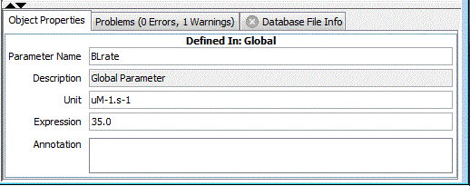
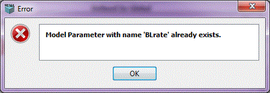

# Parameter Properties Pane

The parameter properties pane allows editing of parameter attributes including name, expression,
units and annotations. Fields in brown cannot be edited. **Note:**

- **Description** cannot be changed for any type of parameter.
- For 'Reaction' parameters that are not user-defined, only **Name** and **Expression** of parameter
  can be changed.
- For 'Application' parameters, only their **Expression** can be changed.

**Edit** the Parameter Name in the field. If a name already exists, an error dialog is shown, and
the name is rejected.

