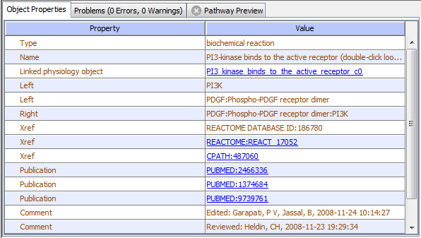

# Pathways Object Properties Pane

For every selected object in the top view the bottom pane of the window displays Object Properties,
such as name, linked physiology objects, reaction participants for reaction, clickable links to
original databases and publications, comments etc.

The first column displays the name of the property, the second column displays its value. Properties
and values are read-only. **Blue underlined** items are **hyperlinks** to various resources. Double
clicking on any hyperlink opens a default web browser with the linked web page.

