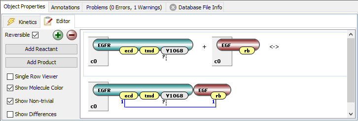
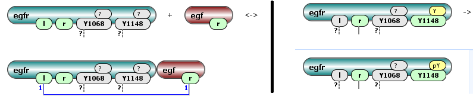
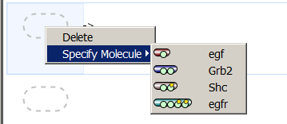
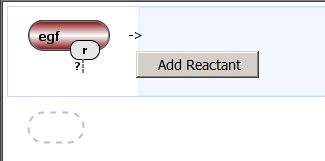
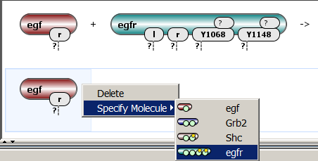
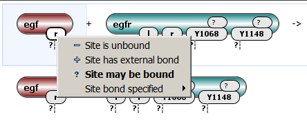
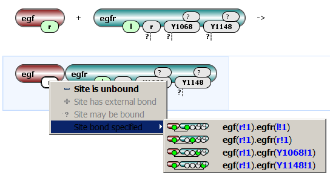
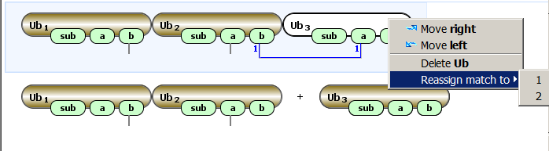

# Reactions Rules Editor Pane

The reaction rules editor pane is currently the only way to specify and edit a reaction rule.

Each reaction rule is specified on two lines, with reactants on the firsl line and products
underneath. This way a modeler can easily see the transformation of reactants to products. Sites in
white are fully unspecified (they can be bound or unbound, denoted by grey question mark under the
site). Sites in green must have either binding status defined (bound to specific site - denoted by
color bond with index, bound to arbitrary site - denoted by vertical line , unbound), or state
defined. The first rule describes binding of egfr monomer (site r is unbound) to free egf (site r is
unbound). The second rule describes phosphorylation of unbound Y1148 site (change of state from Y to
P) on a receptor that is bound to another receptor (site r is bound) but may be bound to a ligand
(question mark under l site) and site Y1068 may be in any state and may be either bound or not.

**Reaction Rule edit/specification:**

- Right click mouse on the first shape to select the first molecule for the first reactant.

  

- To add more reactants, right click on the empty space next to reaction arrow:

  

- To specify reactant or product consisting of multiple molecules, right click next to the existing
  molecule.

  

- Specify how molecules are connected by mouse right click on binding site shape. All changes on
  reactants are propagated to products:

  

- Specify explicit bonds by mouse right click on state shape. Changes in products do not propagate
  to reactions.

  

**Note:** If reaction rule has multiple identical molecules, they are enumerated to provide
one-to-one mapping from reactants to products. The match is established automatically, but can be
reassigned with a right click on a molecular shape.

