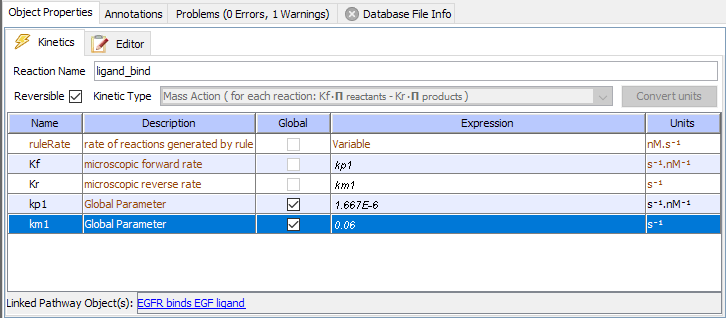

# Reactions Rules Kinetics Pane

The reaction properties panel is used to display and edit kinetics and annotations for a reaction
rule.

The kinetics pane shows the Reaction Name and a table of the kinetic terms used to define the
reaction rate. Items in brown cannot be edited.

**Note** that the rate defined for a reaction rule may differ from the actual reaction rate.
Reaction rules can currently only be defined using mass action kinetics.

- For a reaction generated by a rule, the rate law is defined as the **microscopic forward rate**
  times the concentration(s) of the reactant species minus the **microscopic reverse rate** times
  the concentration(s) of the product species.
- The **microscopic rate** is a rate derived from first principles based on the probability that
  particles in an ideal gas will collide. However, a reaction rule can generate multiple reactions
  and in some reactions the total number of product particles will be the same as the reactant
  particles; in this case the rate is automatically adjusted by
  [BioNetGen](../Appendix/Definitions.md#bionetgen) network generation engine. For example, if the
  rule rate for a+b -> is k, and the rule generates a reaction c+c-> c2, then the rate for the
  reaction will be 0.5k
- Forward rate and reverse rate may be any expressions, but cannot depend on concentrations of other
  species.

**Edit the reaction name** using the text field. A name already given to another reaction will be
rejected.

**Make reaction reversible** by checking the Reversible box. This box must be checked to enable
specification of the reverse rate. When the box is checked, the user can edit the reverse rate
expression. Checking the Reversible box in the kinetic pane also checks the box in the editor pane,
and vice versa.

**Edit the expression** for the forward rate and, if the reversible box is checked, for the reverse
rate in the Expression column. If references to new parameters are added, new rows will
automatically be added for those parameters. An expression for each new parameter must be added in
the Expression column. Parameters can be set to
[global](../Appendix/Definitions.md#global-parameter) or
[local](../Appendix/Definitions.md#local-parameter) using the checkbox. The reaction rule rate is
always local; species concentrations and universal constants are always global.

**Edit units** for the rate expression in the Units column. Incompatible units will be silently
rejected.

**Add or Edit Annotations** for the reaction rule using the [Annotations](PP_Annotations.md) tab in
the Properties Pane.
