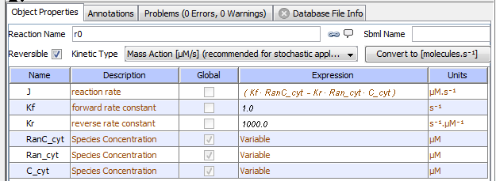

# Reactions Properties Pane

The reaction Properties pane is used to display and edit properties of a reaction.

The Object Properties for a Reaction shows the Reaction Name,a combobox for Kinetic Type, and a
button to convert the rate law either from molecules per second to micromolar per second or vice
versa. A link or text bubble icon next to the reaction name indicates an associated link or text
annotation associated with the reaction. Click the icon to navigate to the Annotations Pane. Below
is a table of the kinetic terms used to define the reaction rate (J) that includes all terms
referred to in the mathematical expression for J or for expressions for other kinetic terms. Items
in brown cannot be edited.

**Edit the reaction name** using the text field. A name already given to another reaction will be
rejected.

**Make reaction reversible** using the checkbox underneath the reaction name. The checkbox is only
visible when the appropriate kinetic type is selected.

**Select a rate law** using the combobox to select one of a few predefined rate laws (mass action,
Michaelis-Menten reversible and irreversible) in concentration per time (micromolar per second if
the model uses the default unit structure) or to enter a user-defined rate law, either in micromolar
per second or in molecules per second (again, assuming default units).

**Convert the rate law** from micromolar per second to molecules per second, or vice versa, using
the **Convert to** button. Note that predefined laws are only in micromolar per second, so if they
are converted to molecules per second, the user-defined kinetic law will automatically be selected,
and remain so even if converted back.

**Edit Expressions and their units** in the Expression column. An autofill menu will dropdown as you
type to easily find already defined parameters and species that can be included in the expression.
Species entered in the rate expression will automatically be assigned as catalysts.

- Predefined rate laws, species concentrations and universal constants cannot be edited.
- Incompatible units will be silently rejected.
- If references to new terms are added, new rows will automatically be added for these terms. An
  expression for each new term must be added in the expression column
- Terms can be set to [global](../Appendix/Definitions.md#global-parameter) or
  [local](../Appendix/Definitions.md#local-parameter) using a checkbox, except for the reaction
  rate, which is always local. Species concentrations and universal constants are always global.

**Add or Edit Annotations** for the reaction using the [Annotations](PP_Annotations.md) tab in the
Properties Pane.

The [Problems](PP_Problems.md)shows warnings and errors in the model. The Biomodel cannot be saved
to the database if Errors indicated, however the model can be exported as a VCML file.
