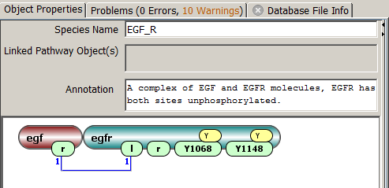
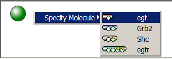
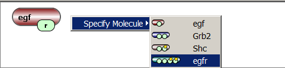
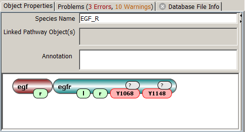
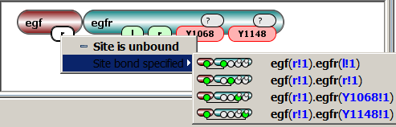
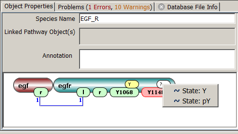

# Species Properties Pane

Selecting a species in the [Reaction Diagram](../Physiology/ReactDiagView.md) or the
[Species Table](../Physiology/SpeciesTabView.md) will activate the Species Properties pane in the
lower right quadrant of the workspace. Within this pane, the Species Name can be editing,
[Linked Pathway Object(s)](../BiologicalPathways/PathwayOverview.md) are displayed, and
[Annotations](PP_Annotations.md) cans be added.

For rule-based models, the **Object Properties** tab provides a graphical editor to specify and edit
the molecular details of [Species](../Physiology/SpeciesTabView.md) using drop-down menus.

**Create a New Species** using the New Species button. For a compartment based model a drop down box
will appear to select the compartment where the species is located.

**Specify molecular components** for a species by adding molecules previously created in the
[Molecules Table](../Physiology/Molecules.md) as a component of a species in a rule-based model. All
states must be explicitly defined (no "Any" for state definition) and the state of the binding sites
must be specified; all bonds must be either "None" or "Explicit."

**Add additional information** about the molecular components in the species. When a molecule is
added, if additional information is required the species will be highlighted in red and errors may
appear in the [Problems tab](PP_Problems.md). In the figure shown, three errors were identified. Two
errors arise from the fact that two binding sites have unspecified states; one error arises because
molecules within the species are not connected with a bond.

**Specify connections** between molecules in the species by right click on binding site shape and
selecting from the drop-down menu

**Specify states** for binding sites by mouse right click on state shape and selecting the cognate
binding site. In the figure shown, the number of errors is now one; bounds between molecules are
specified connected and only one site has unspecified states.

