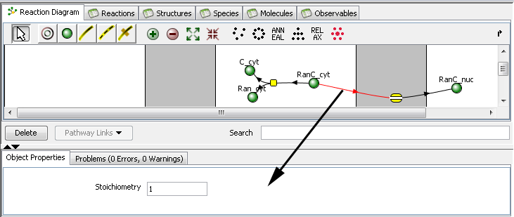

# Stoichiometry Tab

On selection of a reactant or product **line** in the reaction diagram (only for non rule-based
models), the stoichiometry properties panel appears below and can be. used to edit the
stoichiometric coefficient. The default setting is 1.

**Edit** the stoichiometric coefficient in the text field. Only positive integers are allowed; all
other values are silently discarded.
