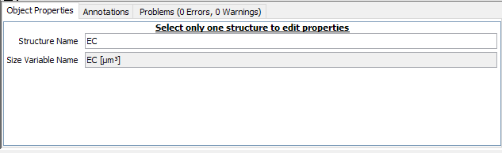
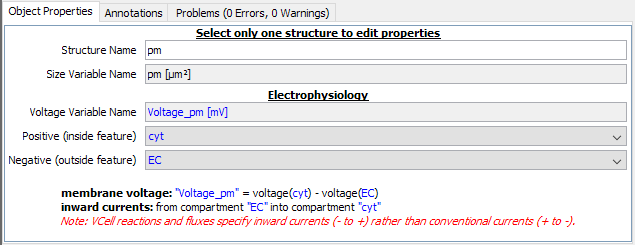

# Structure Properties Pane

The structure properties pane allows editing of the structure name and free text annotations. It
also shows the size variable name and the voltge variable name (for membranes).

**Volume Structure Properties**

- Structure name: Name of the selected volume structure in the model.
- Size variable name: Variable having a numerical value equal to the selected volume structure's
  size in a simulation geometry.
- **Add or Edit Annotations** for the structure using the [Annotations](PP_Annotations.md) tab in
  the Properties Pane.

**Membrane Structure Properties**

- Structure name: Name of the selected membrane structure in the model.
- Size variable name: Variable having a numerical value equal to the selected membrane structure's
  size in a simulation geometry.
- Voltage variable name: Variable having a numerical value equal to (voltage(positive feature) -
  voltage(negative feature))
- Positive (inside feature): The volume structure used in calculation of "voltage variable"
- Negative (outside feature): The volume structure used in calculation of "voltage variable"
- **Add or Edit Annotations** for the structure using the [Annotations](PP_Annotations.md) tab in
  the Properties Pane.
