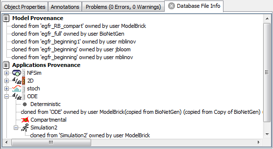
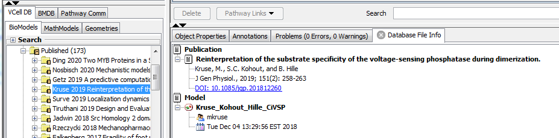

# VCell Database Info Panel

The **Database File Info tab** (**lower right** of a BioModel document window) displays basic
information about a model as it is stored in the VCell Database. The summary displays information
about some of the internal contents of a model. In the Welcome window, the same information is shown
when you hover over a model in the **VCell Database** lists.

The tab appears when you select the open BioModel itself (the top node of the tree in the **upper
left**). It reflects the model's **last saved version**, as a notice at the top of the tab points
out, so changes made since then do not appear. A model that has never been saved to the VCell
Database has no database record; the tab is then titled **Database File Info — NOT SAVED** and asks
you to save the model.

**BioModels** contain 1 or more 'Applications', each application may contain 1 or more simulations.

- **Applications info** See [Application Properties](PP_ApplicationProps.md) (application name,
  type, annotation, geometry, simulation names). See also
  [Applications Overview](../BioModelApplications/ApplicationOverview.md) for more information.

**MathModels** are like stand-alone 'Applications' and contain 1 or more simulations.

- **Type** (e.g 'deterministic').
- **Geometry** ('compartmental' or 'geometry name' and (1D,2D,3D dimension)).
- **Simulation Names**

Information about Published Models is displayed in a different, publication-centric format.

