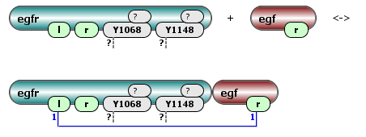
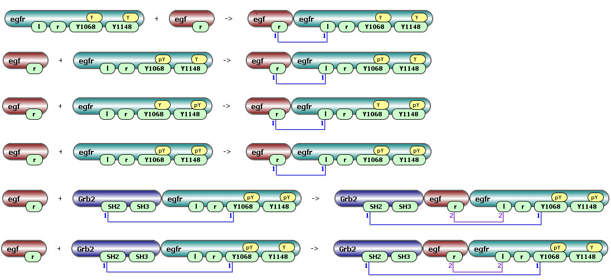

# Introduction to Rule-Based Modeling

A [rule-based](../Appendix/Definitions.md#rule-based) model is specified as a set of
[reaction rules](../Appendix/Definitions.md#reaction-rules), which are associated with specific rate
laws. Given a set of seed [species](../Physiology/SpeciesTabView.md),
[reaction rules](../Appendix/Definitions.md#reaction-rules) identify those species that have the
features required to undergo the transformation from reactants to products specified in the reaction
rule. Interactions represented in a reaction rule are independent of features not explicitly
indicated in the reaction rule. Thus, multiple species may qualify as reactants in a set of
reactions defined by a single reaction rule.

The modeler can define which components and modifications of a
[molecule](../Physiology/Molecules.md) or molecular assembly affect a particular chemical
transformation, and which do not. Furthermore, the modeler has the ability to account for steric
interference, cooperativity, and any other factors that might influence the rate of a reaction. A
reaction rule can state, for example, that “any cell-surface monomeric receptor having an available
extracellular binding site and any free extracellular ligand can interact and form a ligand–receptor
complex; the probability of this interaction depends only on the total numbers of cell-surface
monomeric receptors and extracellular ligands and does not depend on the specific state of the
receptor cytosolic domain.” In this example, we assume that the state of the cytoplasmic domain of
the receptor does not affect ligand–receptor binding, and thus to parameterize all the reactions
specified by the ligand–receptor interaction rule requires just two rate constants: on and off
rates.

The rule below depicts the EGF receptor with a binding site for egf (l), a second unspecified site
(r) and two phosphorylation sites (Y1068 and Y11848) that can be phosphorylated, unphosphorylated,
bound or unbound, combining with an EGF molecule with a receptor binding site (r):

Some of the possible reactions generated by this rule are:

