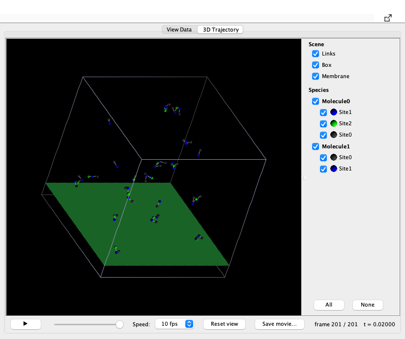

# SpringSaLaD Results

A finished [SpringSaLaD simulation](LangevinApp.md) produces two different kinds of result, and the
results window has a tab for each. **View Data** holds the counters - how many molecules, how many
bound sites, how the numbers change over time. **3D Trajectory** holds the positions - every
particle, at every stored snapshot, in the box it moved through.

Which tabs appear depends on what the run produced:

- **View Data** - always. Its contents differ between a single trajectory and multiple runs,
  described below.
- **3D Trajectory** - whenever the dataset carries stored snapshots, which is any Langevin run.
- **Langevin Clusters** - only when cluster tracking produced data.

**View Data, after a single trajectory.** The ordinary plot and spreadsheet, over the counters the
solver wrote rather than over observables. For each molecule there are three: **TOTAL\_**,
**FREE\_** and **BOUND\_**, and each state of each site is counted the same way. The Plot / Data
buttons under the graph switch between the curve and the numbers behind it.

**View Data, after multiple runs.** The tab is replaced by a panel built for comparing runs. On the
left, choose what to show:

- **Molecules**, **Bound Sites**, **Free Sites** or **Total Sites** - which family of counters;
- **Average**, **Min / Max** or **Standard Deviation** - what to show about the spread across the
  independent runs.

This is the reason to ask for multiple runs at all. A single stochastic trajectory of a few hundred
particles is noisy enough that its shape is not the model's answer; the average over several runs,
with the spread drawn around it, is.

**Langevin Clusters.** When cluster tracking is on, this tab reports how molecules aggregated:
**Cluster Counts**, **Cluster Mass**, **Cluster Mean** and **Cluster Overall**. Cluster tracking
generates a lot of data, so it is worth turning on only when aggregation is the question being
asked.

**The 3D Trajectory viewer.** A play-back of the run: every molecule drawn as its sites, joined by
its links, inside the simulation box with the membrane drawn as a plane.

- **Drag** to rotate the scene, and use the **mouse wheel** to zoom. **Reset view** puts the camera
  back.
- The **slider** along the bottom steps through the stored snapshots; the readout beside it names
  the frame and its time. How many snapshots there are is set by the Image Interval in the solver
  options, not by the output interval.
- **Play** runs through them at the chosen frame rate.
- **Save movie...** writes the sequence out as a video.
- **Links**, **Box** and **Membrane** show and hide those parts of the scene.
- The **Species** tree gives every molecule and every one of its sites a checkbox, with **All** and
  **None** beneath. Hiding everything except one site type is the quickest way to see what that site
  is doing in a crowded box.

**A note on colour.** The viewer draws on a black background, so sites given a dark colour are hard
to see or invisible. Colours are set per site on the
[Molecular Structures](../BioModelApplications/Specifications/SSSpeciesSpecifications.md) tab, and
the reserved Anchor site defaults to DARK_GRAY - which reads perfectly well in the tables and the
molecule diagram, and disappears here. If a molecule seems to be missing from the scene, check its
colours before its coordinates.
